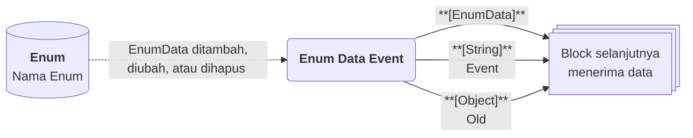

# Enum Data Event

>**note** Enum Data Event merupakan salah satu [[Docs/Modul Logic/Flow/Flow Block/Event/Pengenalan|Flow Block Event]] dalam komponen [[Docs/Modul Logic/Flow/Apa itu Flow|Flow]] di Phoenix.

Enum Data Event adalah Flow Block Event yang memulai alur setiap kali [[Docs/Tipe Data/EnumData]] pada komponen [[Docs/Modul Data/Enum/Apa itu Enum|Enum]] ditambahkan, diperbarui, atau dihapus. Block ini menghasilkan tiga output: [[^output|EnumData]] yang berubah, [[^output|Event]] yang menjelaskan jenis perubahannya, dan [[^output|Old]] yang berisi nilai sebelum perubahan.

Karena Enum menyimpan data master seperti pilihan, menu, dan kategori, block ini berguna untuk menjaga sistem lain tetap selaras ketika daftar pilihan berubah.

![[Docs/Modul Logic/Flow/Flow Block/Event/enum-data-event.png|Enum Data Event Block pada Blueprint]]

<!--
  * [DONE] Letakkan potongan gambar Enum Data Event dari screenshot (file `enum-data-event.png`). Anotasi yang disarankan: nomor 1 pada judul, nomor 2 pada tombol Trigger, nomor 3 pada output EnumData, Event, dan Old.
  * [TODO] Screenshot yang diberikan hanya menampilkan output EnumData pada block ini. Draf mengikuti informasi penulis bahwa block ini juga memiliki output Event dan Old. Perbarui gambar bila sudah tersedia.
    Jawaban: Oke
-->

## Kapan Enum Data Event Terpicu

Enum Data Event terpicu ketika EnumData pada Enum yang terhubung mengalami salah satu dari tiga peristiwa berikut.

| Peristiwa | Nilai [[^output|Event]] |
| --- | --- |
| EnumData baru ditambahkan | [[^value/string|create]] |
| EnumData yang sudah ada diperbarui | [[^value/string|update]] |
| EnumData dihapus | [[^value/string|delete]] |

## Input, Control dan Output

Enum Data Event tidak memiliki input koneksi. Block ini memiliki tiga output di sisi kanan.

| Bagian | Jenis | Tipe Data | Penjelasan |
| --- | --- | --- | --- |
| [[^button/empty\|Trigger]] | Control | - | Memicu Enum Data Event secara manual dari Blueprint. |
| [[^output|EnumData]] | Output | [[Docs/Tipe Data/EnumData]] | EnumData yang ditambahkan, diperbarui, atau dihapus. |
| [[^output|Event]] | Output | [[Docs/Tipe Data/String]] | Jenis peristiwa: [[^value/string|create]], [[^value/string|update]], atau [[^value/string|delete]]. |
| [[^output|Old]] | Output | [[Docs/Tipe Data/Object]] | Nilai EnumData sebelum perubahan. Isinya bergantung pada nilai [[^output|Event]]. |

### Isi Output Berdasarkan Event

| Nilai [[^output|Event]] | Isi [[^output|EnumData]] | Isi [[^output|Old]] |
| --- | --- | --- |
| [[^value/string|create]] | EnumData yang baru ditambahkan. | [[^value/empty]], karena EnumData belum ada sebelumnya. |
| [[^value/string|update]] | EnumData dengan nilai terbaru. | Hanya field yang diubah (Name, Description, Value, atau Selectable), berisi nilai sebelum perubahan. Jika tidak ada perubahan, [[^value/empty]]. |
| [[^value/string|delete]] | EnumData yang dihapus. | Seluruh field: Name, Description, Value, dan Selectable. |

Aturan [[^output|Event]] dan [[^output|Old]] yang sama juga berlaku pada [[Docs/Modul Logic/Flow/Flow Block/Event/Pengenalan#Output Event dan Old|Table Row Event dan Tree Node Event]].

## Menggunakan Enum Data Event

1. Klik kanan pada bagian kosong Blueprint ➜ [[^field/add|Add]] ➜ [[^field|Event]] ➜ [[^field|Enum Data Event]].
2. Buka halaman kerja [[Docs/Modul Data/Enum/Apa itu Enum|Enum]], klik [[^button/event|Event]], lalu hubungkan dengan Enum Data Event. Langkah lengkap ada di [[Docs/Modul Data/Enum/Mengotomasi]] dan [[Docs/Event/Menghubungkan Event|Menghubungkan Event]].
3. Hubungkan output [[^output|EnumData]], [[^output|Event]], atau [[^output|Old]] ke input block berikutnya. Langkah lengkap ada di [[Docs/Modul Logic/Flow/Flow Block/Menghubungkan Koneksi|Menghubungkan Koneksi]].

>**note** Memakai Event dan Function Access
> Menghubungkan Event dari komponen dibatasi Function Access **Modify Event** di Workspace. Selengkapnya lihat [[Docs/Modul Developer/Workspace/Apa itu Workspace|Workspace]].

## Contoh Penggunaan

Contoh berikut memakai Enum kategori dengan EnumData yang memiliki field Name, Description, Value, dan Selectable. Setiap contoh menunjukkan kombinasi output yang diterima block berikutnya.

### Integrasi ketika ada EnumData baru

Gunakan ketika pilihan baru yang Anda tambahkan perlu dikirim ke sistem lain agar daftar pilihannya sama.

| Peristiwa | Output [[^output|EnumData]] | Output [[^output|Event]] | Output [[^output|Old]] |
| --- | --- | --- | --- |
| Pilihan baru ditambahkan | EnumData dengan Name [[^value/string|Elektronik]], Selectable [[^value/boolean/true|Yes]] | [[^value/string|create]] | [[^value/empty]] |

Kombinasi yang berguna: [[^output|EnumData]] untuk mengirim pilihan baru beserta Value-nya, [[^output|Event]] untuk memastikan hanya [[^value/string|create]] yang diteruskan.

### Otomasi ketika EnumData diperbarui

Gunakan ketika perubahan pilihan perlu ditindaklanjuti, misalnya pilihan yang tidak lagi dapat dipilih.

| Peristiwa | Output [[^output|EnumData]] | Output [[^output|Event]] | Output [[^output|Old]] |
| --- | --- | --- | --- |
| Hanya Selectable diubah dari [[^value/boolean/true|Yes]] menjadi [[^value/boolean/false|No]] | EnumData dengan Selectable [[^value/boolean/false|No]] | [[^value/string|update]] | Hanya [[^value/object|{ “Selectable”: true }]] |
| Name dan Description diubah bersamaan | EnumData dengan Name dan Description terbaru | [[^value/string|update]] | Name dan Description dengan nilai sebelumnya |
| Disimpan tanpa ada perubahan | EnumData yang sama | [[^value/string|update]] | [[^value/empty]] |

Kombinasi yang berguna: bandingkan [[^output|Old]] dengan [[^output|EnumData]] untuk mengetahui field mana yang berubah, misalnya hanya meneruskan jika Selectable berubah.

### Otomasi ketika EnumData dihapus

Gunakan ketika pilihan yang dihapus perlu dicatat atau dihapus juga di sistem lain.

| Peristiwa | Output [[^output|EnumData]] | Output [[^output|Event]] | Output [[^output|Old]] |
| --- | --- | --- | --- |
| Pilihan dihapus | EnumData yang dihapus | [[^value/string|delete]] | Seluruh field: Name, Description, Value, dan Selectable |

Kombinasi yang berguna: [[^output|Old]] menyimpan seluruh isi EnumData yang dihapus, sehingga Anda masih dapat mengirim Name dan Value pilihan tersebut.

<!--
  * [DONE] Nama Enum dan nilai pada contoh (kategori, Elektronik) adalah penamaan generik buatan Claude. Sesuaikan bila perlu.
  * [TODO] Konfirmasi field EnumData yang dapat muncul di [[^output|Old]] (Name, Description, Value, Selectable) dan apakah perubahan Selectable juga memicu [[^value/string|update]].
    Jawaban: Sudah benar
  * [TODO] Konfirmasi apakah [[^output|EnumData]] pada [[^value/string|delete]] berisi EnumData terakhir sebelum dihapus.
    Jawaban: Iya betul
  * [TODO] Konfirmasi path `Docs/Modul Data/Enum/Event` dan nama tombol Event pada langkah 2.
    Jawaban: Sudah saya perbaiki
    
-->

## Lihat Juga

- [[Docs/Modul Logic/Flow/Flow Block/Event/Pengenalan|Flow Block Event]]
- [[Docs/Modul Data/Enum/Apa itu Enum|Enum]]
- [[Docs/Modul Data/Enum/Mengotomasi|Mengotomasi Enum]]
- [[Docs/Modul Logic/Flow/Flow Activity|Flow Activity]]
