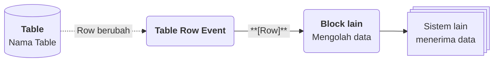

# Flow Block Event

>**note** Flow Block Event merupakan salah satu kategori [[Docs/Modul Logic/Flow/Flow Block/Pengenalan|Flow Block]] dalam komponen [[Docs/Modul Logic/Flow/Apa itu Flow|Flow]] di Phoenix.

Flow Block Event adalah kategori Flow Block yang menjadi **titik awal** sebuah alur di Blueprint. Setiap alur di [[Docs/Modul Logic/Flow/Apa itu Flow|Flow]] dimulai dari satu atau beberapa block Event, lalu hasilnya diteruskan ke block kategori lain untuk diolah, disimpan, atau dikirim ke sistem lain.

Berbeda dengan kategori lain yang bekerja setelah menerima data dari block sebelumnya, block Event menunggu peristiwa dari luar Flow, misalnya perubahan [[Docs/Tipe Data/Row]] pada Table, jadwal dari Timeline, atau tombol yang ditekan. Ketika peristiwa itu terjadi, block Event menghasilkan output yang menjadi bahan awal bagi seluruh alur di sebelah kanannya.

![[Docs/Modul Logic/Flow/Flow Block/Event/flow-block-event.png|Lima Flow Block Event pada Blueprint: Pulser, Enum Data Event, Table Row Event, Tree Node Event, dan Variable Event]]

## Peran Event dalam Flow

Setiap Flow Block memiliki peran yang berbeda dalam sebuah alur. Flow Block Event berada di posisi paling awal:

Block Event tidak memiliki input koneksi, hanya output di sisi kanan. Karena itu block Event tidak dapat dihubungkan dari block lain dan tidak terkena syarat eksekusi yang berlaku pada block non-Event. Selengkapnya lihat [[Docs/Modul Logic/Flow/Flow Block/Syarat Eksekusi|Syarat Flow Block Diproses]].

## Jenis Flow Block Event

Phoenix menyediakan lima Flow Block Event. Empat di antaranya terhubung dengan komponen [[Docs/Modul Data/Variable/Apa itu Variable|Variable]], [[Docs/Modul Data/Enum/Apa itu Enum|Enum]], [[Docs/Modul Data/Table/Apa itu Table|Table]], dan [[Docs/Modul Data/Tree/Apa itu Tree|Tree]], sedangkan Pulser dipicu secara langsung.

| Block | Terpicu ketika | Output |
| --- | --- | --- |
| [[Docs/Modul Logic/Flow/Flow Block/Event/Pulser|Pulser Event Block]] | Tombol [[^button/empty|Trigger]] ditekan, jadwal [[Docs/Modul Interface/Timeline/Apa itu Timeline#Mengelola Timeline Event|Timeline Event]] tiba, atau Button pada [[Docs/Modul Interface/Canvas/Apa itu Canvas|Canvas]] ditekan. | `Result` |
| [[Docs/Modul Logic/Flow/Flow Block/Event/Variable Event|Variable Event Block]] | Data pada [[Docs/Modul Data/Variable/Apa itu Variable|Variable]] berubah. | `Variable` |
| [[Docs/Modul Logic/Flow/Flow Block/Event/Enum Data Event|Enum Data Event Block]] | [[Docs/Tipe Data/EnumData]] pada [[Docs/Modul Data/Enum/Apa itu Enum|Enum]] ditambahkan, diperbarui, atau dihapus. | `EnumData`, `Event`, `Old` |
| [[Docs/Modul Logic/Flow/Flow Block/Event/Table Row Event|Table Row Event Block]] | [[Docs/Tipe Data/Row]] pada [[Docs/Modul Data/Table/Apa itu Table|Table]] ditambahkan, diperbarui, atau dihapus. | `Row`, `Event`, `Old` |
| [[Docs/Modul Logic/Flow/Flow Block/Event/Tree Node Event|Tree Node Event Block]] | [[Docs/Tipe Data/Node]] pada [[Docs/Modul Data/Tree/Apa itu Tree|Tree]] ditambahkan, diperbarui, atau dihapus. | `Node`, `Event`, `Old` |

## Anatomi Flow Block Event

Semua Flow Block Event memiliki anatomi yang serupa. Anatomi umum Flow Block dapat dilihat di [[Docs/Modul Logic/Flow/Flow Block/Pengenalan#Anatomi Flow Block|Anatomi Flow Block]], sedangkan pada block Event:

| Bagian | Penjelasan |
| --- | --- |
| Judul | Nama block, misalnya `Table Row Event`. |
| Control | Tombol [[^button/empty|Trigger]] untuk memicu block secara manual dari Blueprint. Tombol ini ada pada kelima block Event. |
| Output | Titik hijau di sisi kanan block. Jumlah dan nama output berbeda pada setiap block. |

## Output Event dan Old

Tiga block Event untuk data, yaitu **Enum Data Event**, **Table Row Event**, dan **Tree Node Event**, memiliki pola output yang sama: satu output untuk data yang berubah (`EnumData`, `Row`, atau `Node`), ditambah output `Event` dan `Old`.

| Output | Tipe Data | Penjelasan |
| --- | --- | --- |
| Data yang berubah (`EnumData`, `Row`, atau `Node`) | [[Docs/Tipe Data/EnumData]], [[Docs/Tipe Data/Row]], atau [[Docs/Tipe Data/Node]] | Data yang menjadi sumber peristiwa. |
| `Event` | [[Docs/Tipe Data/String]] | Jenis peristiwa: `create`, `update`, atau `delete`. |
| `Old` | [[Docs/Tipe Data/Object]] | Nilai data sebelum perubahan. Isinya bergantung pada nilai `Event`. |

Isi `Old` mengikuti aturan berikut:

| Nilai `Event` | Isi `Old` |
| --- | --- |
| `create` | `Empty`, karena data belum ada sebelumnya. |
| `update` | Hanya field yang diubah, berisi nilai sebelum perubahan. Jika hanya satu field yang diubah, `Old` hanya memuat field itu. Jika tidak ada perubahan, `Old` bernilai `Empty`. |
| `delete` | Seluruh field data yang dihapus. |

>**note** Variable Event dan Pulser tidak memiliki output Event dan Old
> [[Docs/Modul Logic/Flow/Flow Block/Event/Variable Event|Variable Event Block]] hanya menghasilkan output `Variable`, dan [[Docs/Modul Logic/Flow/Flow Block/Event/Pulser|Pulser Event Block]] hanya menghasilkan output `Result`.

## Memilih Flow Block Event

| Kebutuhan Anda | Block yang dipilih |
| --- | --- |
| Menjalankan alur secara manual, terjadwal, atau lewat tombol di Canvas. | [[Docs/Modul Logic/Flow/Flow Block/Event/Pulser|Pulser Event Block]] |
| Bereaksi ketika nilai [[Docs/Modul Data/Variable/Apa itu Variable|Variable]] berubah. | [[Docs/Modul Logic/Flow/Flow Block/Event/Variable Event|Variable Event Block]] |
| Bereaksi ketika pilihan pada [[Docs/Modul Data/Enum/Apa itu Enum|Enum]] berubah. | [[Docs/Modul Logic/Flow/Flow Block/Event/Enum Data Event|Enum Data Event Block]] |
| Bereaksi ketika [[Docs/Tipe Data/Row]] pada [[Docs/Modul Data/Table/Apa itu Table|Table]] bertambah, berubah, atau terhapus. | [[Docs/Modul Logic/Flow/Flow Block/Event/Table Row Event|Table Row Event Block]] |
| Bereaksi ketika [[Docs/Tipe Data/Node]] pada [[Docs/Modul Data/Tree/Apa itu Tree|Tree]] bertambah, berubah, atau terhapus. | [[Docs/Modul Logic/Flow/Flow Block/Event/Tree Node Event|Tree Node Event Block]] |

## Menggunakan Flow Block Event

Setiap Flow Block Event digunakan dengan tiga langkah umum:

1. **Tambahkan block** ke Blueprint. Klik kanan pada bagian kosong Blueprint ➜ [[^field/add|Add]] ➜ [[^field|Event]] ➜ pilih block. Langkah lengkap ada di [[Docs/Modul Logic/Flow/Flow Block/Menambahkan|Menambahkan Flow Block]].
2. **Hubungkan sumber Event.** Untuk block yang terkait komponen data, klik tombol [[^button/event|Event]] pada halaman kerja komponen lalu hubungkan dengan block Event. Langkah lengkap ada di [[Docs/Event/Menghubungkan Event|Menghubungkan Event]]. Pulser dihubungkan lewat [[Docs/Modul Interface/Timeline/Apa itu Timeline#Mengelola Timeline Event|Timeline Event]] atau Button pada [[Docs/Modul Interface/Canvas/Apa itu Canvas|Canvas]].
3. **Hubungkan output** ke input block berikutnya. Langkah lengkap ada di [[Docs/Modul Logic/Flow/Flow Block/Menghubungkan Koneksi|Menghubungkan Koneksi]].

Hasil setiap alur dapat dipantau di [[Docs/Modul Logic/Flow/Flow Activity|Flow Activity]].

<!--
  * [TODO] Variable tidak memiliki tombol Event pada bilah navigasi menurut knowledge. Konfirmasi cara Variable Event dihubungkan ke Variable pada langkah 2.
  * [TODO] Halaman yang diusulkan untuk dibuat: `Docs/Event/Menghubungkan Event` (menghubungkan block Event dari komponen), `Docs/Modul Logic/Flow/Flow Block/Menghubungkan Koneksi`, `Docs/Modul Logic/Flow/Flow Block/Menambahkan`, `Docs/Modul Interface/Canvas/Apa itu Canvas`, dan `Docs/Modul Logic/Flow/Flow Activity`.
-->

## Lihat Juga

- [[Docs/Modul Logic/Flow/Flow Block/Pengenalan|Flow Block]]
- [[Docs/Event/Apa itu Event|Event]]
- [[Docs/Modul Logic/Flow/Flow Activity|Flow Activity]]

