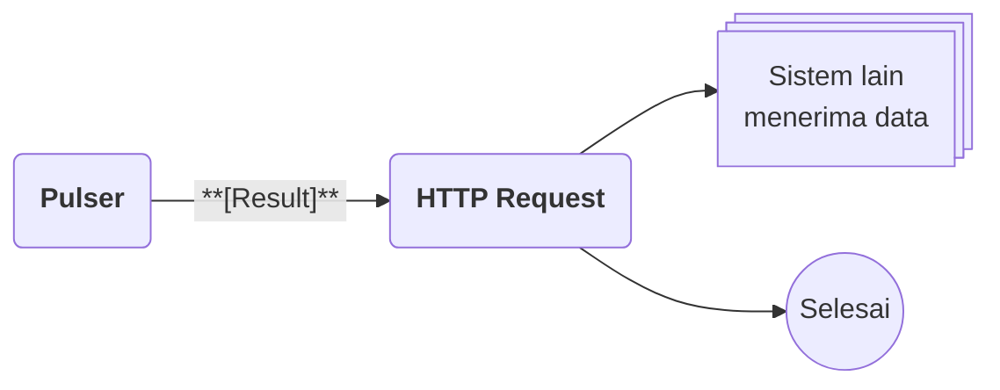
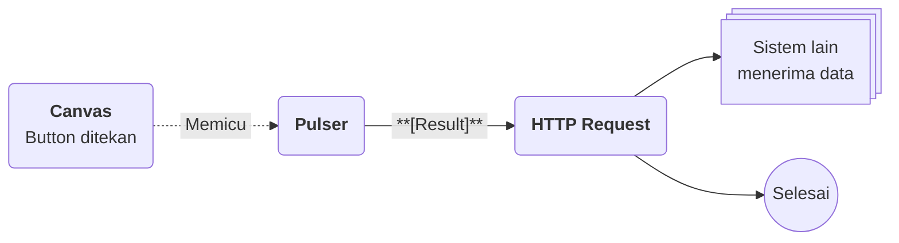
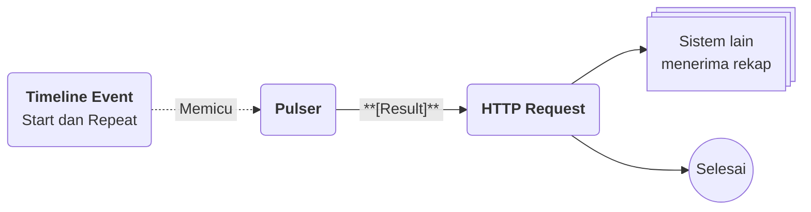

# Flow Block Event : Pulser

>**note** Pulser merupakan salah satu Flow Block kategori [[Docs/Modul Logic/Flow/Flow Block/Event/Pengenalan|Event]] pada komponen [[Docs/Modul Logic/Flow/Apa itu Flow|Flow]] dalam modul [[Docs/Modul Logic/Pengenalan|Logic]] di Phoenix.

Pulser adalah Flow Block Event yang memulai alur ketika dipicu, tanpa terikat pada perubahan data tertentu. Pulser bekerja seperti sinyal: setiap kali dipicu, Pulser menghasilkan [[^field|Result]] yang dapat dihubungkan ke block lain.

Karena tidak bergantung pada data, Pulser cocok untuk alur yang dijalankan sesuai jadwal atau atas permintaan pengguna di antarmuka. Pulser banyak digunakan pada komponen modul Interface, misalnya [[Docs/Modul Interface/Timeline/Apa itu Timeline|Timeline]] dan [[Docs/Modul Interface/Canvas/Apa itu Canvas|Canvas]].

## Kapan Pulser Berjalan

| Pemicu | Penjelasan |
| --- | --- |
| [[^button/empty|Trigger]] | Tombol pada block untuk menjalankan alur secara manual dari antarmuka Flow. |
| [[Docs/Modul Interface/Timeline/Apa itu Timeline#Mengelola Timeline Event|Timeline Event]] | Timeline Event memicu Pulser pada waktu yang ditentukan, dengan atau tanpa pengulangan. Pulser dipilih lewat field [[^field|Pulser Event]]. |
| [[Docs/Modul Interface/Form/Widget/Button/Penjelasan|Button]] pada Canvas | Pengguna menekan Button untuk memicu Pulser. |

>**warning** Button pada Canvas yang dipublikasikan
>Button pada Canvas yang dipublikasikan dapat dipakai oleh publik. Pastikan alur yang dipicu Pulser aman dijalankan oleh siapa saja yang membuka tautan Publish.

## Antarmuka Pulser

![[Docs/Modul Logic/Flow/Flow Block/Event/block-pulser.png]]
### Input

| Input | Penjelasan |
| --- | --- |
| Input pemicu | Tanda segitiga biru di sebelah kiri judul. Input ini memungkinkan block dipicu dan berlaku untuk semua Flow Block. Pada Pulser input ini jarang dibutuhkan, karena Pulser sudah dapat dipicu lewat Trigger, Timeline Event, atau Button. |

### Output

| Output | Tipe Data | Penjelasan |
| --- | --- | --- |
| [[^field|Result]] | [[Docs/Tipe Data/Mixed]] | Hasil pemicuan yang diteruskan ke block berikutnya. Hubungkan ke input block lain untuk memulai alur. |

## Menambahkan dan Menghubungkan Pulser

Tambahkan block lewat menu [[^field/add|Add]] ➜ [[^field|Event]] ➜ [[^field|Pulser]] di Blueprint. Cara lengkapnya ada di [[Docs/Modul Logic/Flow/Flow Block/Pengenalan#Menambahkan Flow Block|Menambahkan Flow Block]]. Setelah itu:

- Hubungkan [[^field|Result]] ke block lain lewat [[Docs/Modul Logic/Flow/Flow Block/Pengenalan#Menghubungkan Koneksi|Menghubungkan Koneksi]].
- Untuk jadwal, pilih Pulser pada field [[^field|Pulser Event]] saat membuat Timeline Event.
- Untuk tombol, hubungkan Button pada Canvas ke Pulser.

## Menjalankan Pulser Secara Manual

1. Buka Flow yang berisi Pulser
2. Klik [[^button/empty|Trigger]] pada Pulser

Alur yang terhubung ke [[^field|Result]] langsung berjalan, dan prosesnya tercatat di [[Docs/Modul Logic/Flow/Flow Activity]].

<!--
  * [TODO] Konfirmasi: apakah Trigger pada Pulser langsung menjalankan alur tanpa modal pemilihan data (asumsi saya).
-->

## Contoh Penggunaan

**Menjalankan alur secara manual**

Anda ingin mengirim ringkasan data ke sistem lain sewaktu-waktu tanpa menunggu perubahan data.

| Block | Peran dalam alur |
| --- | --- |
| [[Docs/Modul Logic/Flow/Flow Block/Event/Pulser|Pulser]] | Memulai alur saat [[^button/empty|Trigger]] diklik. |
| [[Docs/Modul Logic/Flow/Flow Block/Modular/HTTP Request|HTTP Request]] | Mengirim data ke sistem lain begitu [[^field|Result]] diterima. |

**Menjalankan alur dari tombol di Canvas**

Pengguna ingin menjalankan sebuah proses sendiri lewat tombol di halaman, misalnya menyinkronkan data ke sistem lain.

| Block | Peran dalam alur |
| --- | --- |
| [[Docs/Modul Logic/Flow/Flow Block/Event/Pulser|Pulser]] | Menerima pemicu dari [[Docs/Modul Interface/Form/Widget/Button/Penjelasan|Button]] pada Canvas. |
| [[Docs/Modul Logic/Flow/Flow Block/Modular/HTTP Request|HTTP Request]] | Menjalankan sinkronisasi ke sistem lain. |

**Menjalankan alur sesuai jadwal**

Anda ingin sebuah proses berjalan otomatis setiap periode, misalnya mengirim rekap harian.

| Block | Peran dalam alur |
| --- | --- |
| [[Docs/Modul Logic/Flow/Flow Block/Event/Pulser|Pulser]] | Dipicu oleh [[Docs/Modul Interface/Timeline/Apa itu Timeline#Mengelola Timeline Event|Timeline Event]] pada setiap jadwal. |
| [[Docs/Modul Logic/Flow/Flow Block/Modular/HTTP Request|HTTP Request]] | Mengirim rekap ke sistem lain pada setiap jadwal. |

### Variasi Pemicu

| Pemicu | Cocok untuk |
| --- | --- |
| [[^button/empty|Trigger]] | Menguji alur dan menjalankan tugas sesekali. |
| [[Docs/Modul Interface/Timeline/Apa itu Timeline#Mengelola Timeline Event|Timeline Event]] | Tugas terjadwal atau berulang. |
| [[Docs/Modul Interface/Form/Widget/Button/Penjelasan|Button]] | Tugas yang dijalankan pengguna sesuai kebutuhan. |

Dengan Pulser, jadwal dan tombol di antarmuka dapat langsung menjalankan alur yang terhubung ke data dan sistem lain.

<!--
  * [TODO] Nama konteks pada Contoh Penggunaan sudah dibuat generik. Detail input HTTP Request (alamat, metode, isi permintaan) tidak dijelaskan di sini dan perlu disesuaikan dengan halaman HTTP Request.
  * [TODO] Asumsi halaman baru yang ditautkan: Docs/Modul Logic/Flow/Flow Block/Modular/HTTP Request, Docs/Modul Interface/Timeline/Apa itu Timeline#Mengelola Timeline Event, Docs/Modul Interface/Form/Widget/Button/Penjelasan, dan Docs/Modul Logic/Flow/Flow Activity.
-->

## Block Terkait

- [[Docs/Modul Logic/Flow/Flow Block/Event/Pengenalan|Pengenalan Event]]: perbandingan Pulser dengan block Event lain.
- [[Docs/Modul Logic/Flow/Flow Block/Event/Table Row Event|Table Row Event]]: memulai alur dari perubahan data Table.
- [[Docs/Modul Logic/Flow/Flow Block/Modular/HTTP Request|HTTP Request]]: mengirim hasil alur ke sistem lain.
