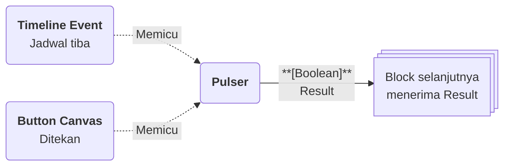

# Pulser

>**note** Pulser merupakan salah satu [[Docs/Modul Logic/Flow/Flow Block/Event/Pengenalan|Flow Block Event]] dalam komponen [[Docs/Modul Logic/Flow/Apa itu Flow|Flow]] di Phoenix.

Pulser adalah Flow Block Event yang memulai alur dengan **denyut pemicu**. Berbeda dengan block Event lainnya, Pulser tidak memantau perubahan data, melainkan menunggu perintah untuk dijalankan: dari tombol [[^button/empty|Trigger]] di Blueprint, dari jadwal [[Docs/Modul Interface/Timeline/Timeline Event/Pengenalan|Timeline Event]], atau dari [[Docs/Modul Interface/Canvas/Widget/Basic/Button|Widget Button]] pada [[Docs/Modul Interface/Canvas/Apa itu Canvas|Canvas]].

![[Docs/Modul Logic/Flow/Flow Block/Event/pulser.png|Pulser Event Block pada Blueprint]]
## Kapan Pulser Terpicu

Pulser terpicu ketika salah satu sumber berikut menjalankannya.

| Sumber | Cara memicu | Frekuensi |
| --- | --- | --- |
| Blueprint | Klik tombol [[^button/empty|Trigger]] pada block. | Setiap kali tombol diklik. |
| [[Docs/Modul Interface/Timeline/Timeline Event/Pengenalan|Timeline Event]] | Pilih Pulser pada field [[^field|Pulser Event]] saat membuat Timeline Event. | Satu kali pada Start, atau berulang bila Repeat aktif. |
| [[Docs/Modul Interface/Canvas/Apa itu Canvas|Canvas]] | Hubungkan [[Docs/Modul Interface/Canvas/Widget/Basic/Button|Widget Button]] ke Pulser. | Setiap kali Button ditekan. |

## Input, Control dan Output

Pulser tidak memiliki input koneksi. Block ini memiliki satu Control berupa tombol dan satu output di sisi kanan.

| Bagian | Jenis | Tipe Data | Penjelasan |
| --- | --- | --- | --- |
| [[^button/empty|Trigger]] | Control | - | Memicu Pulser secara manual dari Blueprint. |
| [[^output|Result]] | Output | [[Docs/Tipe Data/Boolean]] | Selalu bernilai [[^value/boolean/true]] setiap kali Pulser terpicu, lalu diteruskan ke block berikutnya. |

>**note** Tombol Trigger pada Pulser adalah Control
> Tombol [[^button/empty|Trigger]] pada Pulser adalah Control untuk memicu block. Sedangkan Trigger sebagai bagian block yang menjadi syarat eksekusi hanya berlaku pada block non-Event. Selengkapnya lihat [[Docs/Modul Logic/Flow/Flow Block/Pengenalan#Anatomi Flow Block|Anatomi Flow Block]].

## Menggunakan Pulser

1. Klik kanan pada bagian kosong Blueprint ➜ [[^field/add|Add]] ➜ [[^field|Event]] ➜ [[^field|Pulser]].
2. Hubungkan output [[^output|Result]] ke input block berikutnya. Langkah lengkap ada di [[Docs/Modul Logic/Flow/Flow Block/Menghubungkan Koneksi|Menghubungkan Koneksi]].
3. Hubungkan sumber pemicunya ([[Docs/Modul Interface/Timeline/Timeline Event/Pengenalan|Timeline Event]] atau [[Docs/Modul Interface/Canvas/Widget/Basic/Button|Widget Button]]), atau klik [[^button/empty|Trigger]] untuk menjalankan secara manual.

## Contoh Penggunaan

Contoh berikut menunjukkan setiap sumber pemicu Pulser beserta output yang diterima block berikutnya. Setiap pemicu membuat satu Activity baru di [[Docs/Modul Logic/Flow/Flow Activity|Flow Activity]], dan beberapa Activity pada Flow yang sama dapat berjalan paralel.

### Menjalankan alur secara manual

Anda dapat menjalankan alur kapan saja langsung dari Blueprint, misalnya untuk menjalankan proses rekap yang jarang dipakai.

| Aksi | Output [[^output|Result]] |
| --- | --- |
| Klik [[^button/empty|Trigger]] satu kali | Satu Activity baru dengan Result [[^value/boolean/true]]. |
| Klik [[^button/empty|Trigger]] tiga kali berturut-turut | Tiga Activity terpisah, masing-masing dengan Result [[^value/boolean/true]], yang dapat berjalan paralel. |

### Menjalankan alur terjadwal

Hubungkan Pulser ke [[Docs/Modul Interface/Timeline/Timeline Event/Pengenalan|Timeline Event]] agar alur berjalan otomatis pada waktu yang Anda tentukan, misalnya setiap awal pekan.

| Pengaturan Timeline Event | Output [[^output|Result]] |
| --- | --- |
| Repeat nonaktif | Satu Activity pada waktu Start dengan Result [[^value/boolean/true]]. |
| Repeat aktif dengan Interval harian | Satu Activity setiap hari sampai batas End, masing-masing dengan Result [[^value/boolean/true]]. |
| Active dimatikan | Tidak ada Activity, Timeline Event tetap tersimpan. |

### Menjalankan alur dari tombol di Canvas

Hubungkan Pulser ke [[Docs/Modul Interface/Canvas/Widget/Basic/Button|Widget Button]] pada [[Docs/Modul Interface/Canvas/Apa itu Canvas|Canvas]] agar pengguna dapat menjalankan alur dari halaman antarmuka tanpa membuka Flow.

| Aksi pengguna | Output [[^output|Result]] |
| --- | --- |
| Menekan Button satu kali | Satu Activity baru dengan Result [[^value/boolean/true]]. |
| Menekan Button berulang | Satu Activity untuk setiap penekanan, masing-masing dengan Result [[^value/boolean/true]]. |

>**warning** Button pada Canvas yang dipublikasikan dapat dipakai publik
> Jika Canvas dipublikasikan, siapa pun yang membuka tautan dapat menekan Button dan memicu Pulser. Pastikan alur yang dipicu aman dijalankan oleh pengguna publik.

## Lihat Juga

- [[Docs/Modul Logic/Flow/Flow Block/Event/Pengenalan|Flow Block Event]]
- [[Docs/Modul Interface/Timeline/Timeline Event/Pengenalan|Timeline Event]]
- [[Docs/Modul Logic/Flow/Flow Activity|Flow Activity]]
