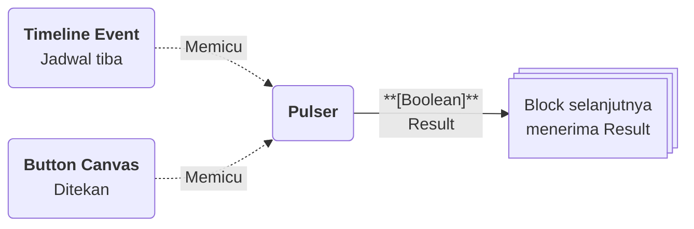

# Pulser

>**note** Pulser merupakan salah satu [[Docs/Modul Logic/Flow/Flow Block/Event/Pengenalan|Flow Block Event]] dalam komponen [[Docs/Modul Logic/Flow/Apa itu Flow|Flow]] di Phoenix.

Pulser adalah Flow Block Event yang memulai alur dengan **denyut pemicu**. Berbeda dengan block Event lainnya, Pulser tidak memantau perubahan data, melainkan menunggu perintah untuk dijalankan: dari tombol [[^button/empty|Trigger]] di Blueprint, dari jadwal [[Docs/Modul Interface/Timeline/Apa itu Timeline#Mengelola Timeline Event|Timeline Event]], atau dari Button pada [[Docs/Modul Interface/Canvas/Apa itu Canvas|Canvas]].

![[Docs/Modul Logic/Flow/Flow Block/Event/pulser.png|Pulser Event Block pada Blueprint]]

<!--
  * [TODO] Letakkan potongan gambar Pulser dari screenshot (file `pulser.png`). Anotasi yang disarankan: nomor 1 pada judul, nomor 2 pada tombol Trigger, nomor 3 pada output Result.
-->

## Kapan Pulser Terpicu

Pulser terpicu ketika salah satu sumber berikut menjalankannya.

| Sumber | Cara memicu | Frekuensi |
| --- | --- | --- |
| Blueprint | Klik tombol [[^button/empty\|Trigger]] pada block. | Setiap kali tombol diklik. |
| [[Docs/Modul Interface/Timeline/Apa itu Timeline#Mengelola Timeline Event\|Timeline Event]] | Pilih Pulser pada field [[^field\|Pulser Event]] saat membuat Timeline Event. | Satu kali pada Start, atau berulang bila Repeat aktif. |
| [[Docs/Modul Interface/Canvas/Apa itu Canvas\|Canvas]] | Hubungkan Widget Button ke Pulser. | Setiap kali Button ditekan. |

## Input dan Output

Pulser tidak memiliki input koneksi. Block ini hanya memiliki satu output di sisi kanan.

| Bagian | Jenis | Tipe Data | Penjelasan |
| --- | --- | --- | --- |
| [[^button/empty\|Trigger]] | Control | - | Memicu Pulser secara manual dari Blueprint. |
| `Result` | Output | [[Docs/Tipe Data/Boolean]] | Hasil denyut Pulser yang diteruskan ke block berikutnya. |

>**note** Tombol Trigger pada Pulser adalah Control
> Tombol [[^button/empty|Trigger]] pada Pulser adalah Control untuk memicu block. Sedangkan Trigger sebagai bagian block yang menjadi syarat eksekusi hanya berlaku pada block non-Event. Selengkapnya lihat [[Docs/Modul Logic/Flow/Flow Block/Pengenalan#Anatomi Flow Block|Anatomi Flow Block]].

## Menggunakan Pulser

1. Klik kanan pada bagian kosong Blueprint ➜ [[^field/add|Add]] ➜ [[^field|Event]] ➜ [[^field|Pulser]].
2. Hubungkan output `Result` ke input block berikutnya. Langkah lengkap ada di [[Docs/Modul Logic/Flow/Flow Block/Menghubungkan Koneksi|Menghubungkan Koneksi]].
3. Hubungkan sumber pemicunya (Timeline Event atau Button Canvas), atau klik [[^button/empty|Trigger]] untuk menjalankan secara manual.

## Contoh Penggunaan

Contoh berikut menunjukkan setiap sumber pemicu Pulser beserta output yang diterima block berikutnya.

### Menjalankan alur secara manual

Anda dapat menjalankan alur kapan saja langsung dari Blueprint, misalnya untuk menjalankan proses rekap yang jarang dipakai.

| Aksi | Output `Result` |
| --- | --- |
| Klik [[^button/empty\|Trigger]] satu kali | Satu denyut dikirim ke block berikutnya. |
| Klik [[^button/empty\|Trigger]] tiga kali berturut-turut | Tiga denyut terpisah, masing-masing menjalankan alur satu kali. |

### Menjalankan alur terjadwal

Hubungkan Pulser ke [[Docs/Modul Interface/Timeline/Apa itu Timeline#Mengelola Timeline Event|Timeline Event]] agar alur berjalan otomatis pada waktu yang Anda tentukan, misalnya setiap awal pekan.

| Pengaturan Timeline Event | Output `Result` |
| --- | --- |
| Repeat nonaktif | Satu denyut pada waktu Start. |
| Repeat aktif dengan Interval harian | Satu denyut setiap hari sampai batas End. |
| Active dimatikan | Tidak ada denyut, Timeline Event tetap tersimpan. |

### Menjalankan alur dari tombol di Canvas

Hubungkan Pulser ke Button pada [[Docs/Modul Interface/Canvas/Apa itu Canvas|Canvas]] agar pengguna dapat menjalankan alur dari halaman antarmuka tanpa membuka Flow.

| Aksi pengguna | Output `Result` |
| --- | --- |
| Menekan Button satu kali | Satu denyut dikirim ke block berikutnya. |
| Menekan Button berulang | Satu denyut untuk setiap penekanan. |

>**warning** Button pada Canvas yang dipublikasikan dapat dipakai publik
> Jika Canvas dipublikasikan, siapa pun yang membuka tautan dapat menekan Button dan memicu Pulser. Pastikan alur yang dipicu aman dijalankan oleh pengguna publik.

<!--
  * [TODO] Konfirmasi apakah Result membawa nilai berbeda pada setiap sumber pemicu (misalnya waktu terpicu atau sumber pemicu). Tabel contoh saat ini mengasumsikan Result hanya berupa denyut.
  * [TODO] Konfirmasi apakah klik Trigger berulang saat alur sebelumnya masih berjalan akan diantrekan atau dijalankan paralel.
  * [TODO] Halaman yang diusulkan untuk dibuat: anchor `Docs/Modul Interface/Timeline/Apa itu Timeline#Mengelola Timeline Event` dan `Docs/Modul Interface/Canvas/Apa itu Canvas`, dengan bagian Button pada Canvas.
-->

## Lihat Juga

- [[Docs/Modul Logic/Flow/Flow Block/Event/Pengenalan|Flow Block Event]]
- [[Docs/Modul Interface/Timeline/Apa itu Timeline#Mengelola Timeline Event|Timeline Event]]
- [[Docs/Modul Logic/Flow/Flow Activity|Flow Activity]]
