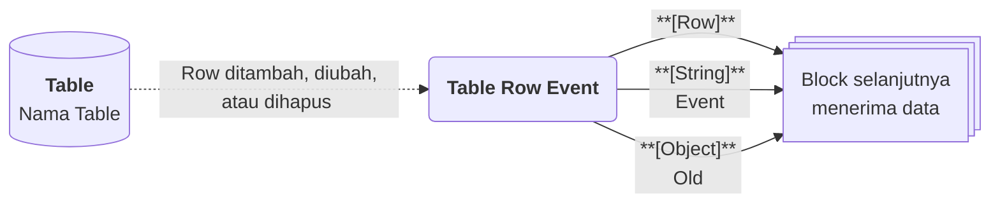

# Table Row Event

>**note** Table Row Event merupakan salah satu [[Docs/Modul Logic/Flow/Flow Block/Event/Pengenalan|Flow Block Event]] dalam komponen [[Docs/Modul Logic/Flow/Apa itu Flow|Flow]] di Phoenix.

Table Row Event adalah Flow Block Event yang memulai alur setiap kali [[Docs/Tipe Data/Row]] pada komponen [[Docs/Modul Data/Table/Apa itu Table|Table]] ditambahkan, diperbarui, atau dihapus. Block ini menghasilkan tiga output: `Row` yang berubah, `Event` yang menjelaskan jenis perubahannya, dan `Old` yang berisi nilai sebelum perubahan.

Dengan satu block ini, Anda dapat mengintegrasikan Row baru ke sistem lain, mengotomasi tindakan saat Row diperbarui, dan menindaklanjuti Row yang dihapus.

![[Docs/Modul Logic/Flow/Flow Block/Event/table-row-event.png|Table Row Event Block pada Blueprint]]

<!--
  * [TODO] Letakkan potongan gambar Table Row Event dari screenshot (file `table-row-event.png`). Anotasi yang disarankan: nomor 1 pada judul, nomor 2 pada tombol Trigger, nomor 3 pada output Row, Event, dan Old.
-->

## Kapan Table Row Event Terpicu

Table Row Event terpicu ketika Row pada Table yang terhubung mengalami salah satu dari tiga peristiwa berikut.

| Peristiwa | Nilai `Event` |
| --- | --- |
| Row baru ditambahkan | `create` |
| Row yang sudah ada diperbarui | `update` |
| Row dihapus | `delete` |

## Input dan Output

Table Row Event tidak memiliki input koneksi. Block ini memiliki tiga output di sisi kanan.

| Bagian | Jenis | Tipe Data | Penjelasan |
| --- | --- | --- | --- |
| [[^button/empty\|Trigger]] | Control | - | Memicu Table Row Event secara manual dari Blueprint. |
| `Row` | Output | [[Docs/Tipe Data/Row]] | Row yang ditambahkan, diperbarui, atau dihapus. |
| `Event` | Output | [[Docs/Tipe Data/String]] | Jenis peristiwa: `create`, `update`, atau `delete`. |
| `Old` | Output | [[Docs/Tipe Data/Object]] | Nilai Row sebelum perubahan. Isinya bergantung pada nilai `Event`. |

### Isi Output Berdasarkan Event

| Nilai `Event` | Isi `Row` | Isi `Old` |
| --- | --- | --- |
| `create` | Row yang baru ditambahkan. | `Empty`, karena Row belum ada sebelumnya. |
| `update` | Row dengan nilai terbaru. | Hanya [[Docs/Tipe Data/Column]] yang diubah, berisi nilai sebelum perubahan. Jika tidak ada perubahan, `Empty`. |
| `delete` | Row yang dihapus. | Seluruh Column dari Row yang dihapus. |

Aturan `Event` dan `Old` yang sama juga berlaku pada [[Docs/Modul Logic/Flow/Flow Block/Event/Pengenalan#Output Event dan Old|Enum Data Event dan Tree Node Event]].

## Menggunakan Table Row Event

1. Klik kanan pada bagian kosong Blueprint ➜ [[^field/add|Add]] ➜ [[^field|Event]] ➜ [[^field|Table Row Event]].
2. Buka halaman kerja [[Docs/Modul Data/Table/Apa itu Table|Table]], klik [[^button/event|Event]], lalu hubungkan dengan Table Row Event. Langkah lengkap ada di [[Docs/Modul Data/Table/Event|Event Table]] dan [[Docs/Event/Menghubungkan Event|Menghubungkan Event]].
3. Hubungkan output `Row`, `Event`, atau `Old` ke input block berikutnya. Langkah lengkap ada di [[Docs/Modul Logic/Flow/Flow Block/Menghubungkan Koneksi|Menghubungkan Koneksi]].

>**note** Memakai Event dan Function Access
> Menghubungkan Event dari komponen dibatasi Function Access **Modify Event** di Workspace. Selengkapnya lihat [[Docs/Modul Developer/Workspace/Apa itu Workspace|Workspace]].

## Contoh Penggunaan

Contoh berikut memakai Table pesanan dengan Column Nomor Pesanan, Status, dan Total. Setiap contoh menunjukkan kombinasi output yang diterima block berikutnya, sehingga Anda dapat memilih output mana yang Anda butuhkan.

### Integrasi ketika ada Row baru

Gunakan ketika setiap pesanan baru perlu langsung dikirim ke sistem lain, misalnya sistem gudang atau pemberitahuan.

| Peristiwa | Output `Row` | Output `Event` | Output `Old` |
| --- | --- | --- | --- |
| Pesanan baru ditambahkan lewat halaman kerja Table | Row dengan Nomor Pesanan `SO-0001`, Status [[^value/enumdata\|Menunggu]], Total `150000` | `create` | `Empty` |
| Pesanan baru ditambahkan lewat Flow Block lain | Row baru yang sama bentuknya | `create` | `Empty` |

Kombinasi yang berguna: `Row` untuk mengirim seluruh isi pesanan, `Event` untuk memastikan hanya `create` yang diteruskan.

### Otomasi ketika Row diperbarui

Gunakan ketika perubahan pada pesanan, misalnya perubahan [[^field/column|Status]], perlu ditindaklanjuti, seperti memberi tahu pelanggan.

| Peristiwa | Output `Row` | Output `Event` | Output `Old` |
| --- | --- | --- | --- |
| Hanya [[^field/column\|Status]] diubah dari [[^value/enumdata\|Menunggu]] menjadi [[^value/enumdata\|Diproses]] | Row dengan Status [[^value/enumdata\|Diproses]] | `update` | Hanya Status: `Menunggu` |
| [[^field/column\|Status]] dan [[^field/column\|Total]] diubah bersamaan | Row dengan Status dan Total terbaru | `update` | Status dan Total dengan nilai sebelumnya |
| Row disimpan tanpa ada perubahan | Row yang sama | `update` | `Empty` |

Kombinasi yang berguna: bandingkan `Old` dengan `Row` untuk mengetahui apa yang berubah dan nilai sebelumnya, misalnya hanya meneruskan jika Status berpindah ke nilai tertentu.

### Otomasi ketika Row dihapus

Gunakan ketika penghapusan pesanan perlu dicatat atau dibatalkan di sistem lain.

| Peristiwa | Output `Row` | Output `Event` | Output `Old` |
| --- | --- | --- | --- |
| Pesanan dihapus lewat kolom Action | Row yang dihapus | `delete` | Seluruh Column: Nomor Pesanan, Status, dan Total |

Kombinasi yang berguna: `Old` menyimpan seluruh isi Row yang dihapus, sehingga Anda masih dapat mengirim data pesanan yang sudah tidak ada di Table.

<!--
  * [TODO] Nama Column dan nilai pada contoh (Nomor Pesanan, Status, Total, SO-0001, Menunggu, Diproses) adalah penamaan generik buatan Claude. Sesuaikan bila perlu.
  * [TODO] Konfirmasi apakah `Row` pada `delete` berisi Row terakhir sebelum dihapus.
  * [TODO] Konfirmasi apakah menyimpan Row tanpa perubahan tetap memicu `update` dengan `Old` Empty, atau tidak memicu Table Row Event sama sekali.
  * [TODO] Konfirmasi apakah Row yang ditambahkan lewat Flow Block lain, import, atau upload juga memicu `create`.
  * [TODO] Konfirmasi path `Docs/Modul Data/Table/Event` dan nama tombol Event pada langkah 2.
-->

## Lihat Juga

- [[Docs/Modul Logic/Flow/Flow Block/Event/Pengenalan|Flow Block Event]]
- [[Docs/Modul Data/Table/Apa itu Table|Table]]
- [[Docs/Modul Data/Table/Event|Event Table]]
- [[Docs/Modul Logic/Flow/Flow Activity|Flow Activity]]
