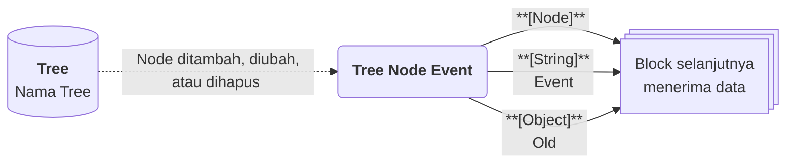

# Tree Node Event

>**note** Tree Node Event merupakan salah satu [[Docs/Modul Logic/Flow/Flow Block/Event/Pengenalan|Flow Block Event]] dalam komponen [[Docs/Modul Logic/Flow/Apa itu Flow|Flow]] di Phoenix.

Tree Node Event adalah Flow Block Event yang memulai alur setiap kali [[Docs/Tipe Data/Node]] pada komponen [[Docs/Modul Data/Tree/Apa itu Tree|Tree]] ditambahkan, diperbarui, atau dihapus. Block ini menghasilkan tiga output: [[^output|Node]] yang berubah, [[^output|Event]] yang menjelaskan jenis perubahannya, dan [[^output|Old]] yang berisi nilai sebelum perubahan.

Karena Tree menyimpan data berbentuk hierarki, block ini berguna untuk menjaga struktur di sistem lain, seperti struktur organisasi atau kategori bertingkat, tetap sama dengan di Phoenix.

![[Docs/Modul Logic/Flow/Flow Block/Event/tree-node-event.png|Tree Node Event Block pada Blueprint]]

<!--
  * [DONE] Letakkan potongan gambar Tree Node Event dari screenshot (file `tree-node-event.png`). Anotasi yang disarankan: nomor 1 pada judul, nomor 2 pada tombol Trigger, nomor 3 pada output Node, Event, dan Old.
-->

## Kapan Tree Node Event Terpicu

Tree Node Event terpicu ketika Node pada Tree yang terhubung mengalami salah satu dari tiga peristiwa berikut.

| Peristiwa | Nilai [[^output|Event]] |
| --- | --- |
| Node baru ditambahkan | [[^value/string|create]] |
| Node yang sudah ada diperbarui | [[^value/string|update]] |
| Node dihapus | [[^value/string|delete]] |

## Input, Control dan Output

Tree Node Event tidak memiliki input koneksi. Block ini memiliki satu control dan tiga output.

| Bagian | Jenis | Tipe Data | Penjelasan |
| --- | --- | --- | --- |
| [[^button/empty\|Trigger]] | Control | - | Memicu Tree Node Event secara manual dari Blueprint. |
| [[^output|Node]] | Output | [[Docs/Tipe Data/Node]] | Node yang ditambahkan, diperbarui, atau dihapus. |
| [[^output|Event]] | Output | [[Docs/Tipe Data/String]] | Jenis peristiwa: [[^value/string|create]], [[^value/string|update]], atau [[^value/string|delete]]. |
| [[^output|Old]] | Output | [[Docs/Tipe Data/Object]] | Nilai Node sebelum perubahan. Isinya bergantung pada nilai [[^output|Event]]. |

### Isi Output Berdasarkan Event

| Nilai [[^output|Event]] | Isi [[^output|Node]] | Isi [[^output|Old]] |
| --- | --- | --- |
| [[^value/string|create]] | Node yang baru ditambahkan. | [[^value/empty]], karena Node belum ada sebelumnya. |
| [[^value/string|update]] | Node dengan nilai terbaru. | Hanya field yang diubah (Name, Order, atau Children), berisi nilai sebelum perubahan. Jika tidak ada perubahan, [[^value/empty]]. |
| [[^value/string|delete]] | Node yang dihapus. | Seluruh field Node yang dihapus. |

Aturan [[^output|Event]] dan [[^output|Old]] yang sama juga berlaku pada [[Docs/Modul Logic/Flow/Flow Block/Event/Pengenalan#Output Event dan Old|Table Row Event dan Enum Data Event]].

## Menggunakan Tree Node Event

1. Klik kanan pada bagian kosong Blueprint ➜ [[^field/add|Add]] ➜ [[^field|Event]] ➜ [[^field|Tree Node Event]].
2. Buka halaman kerja [[Docs/Modul Data/Tree/Apa itu Tree|Tree]], klik [[^button/event|Event]], lalu hubungkan dengan Tree Node Event. Langkah lengkap ada di [[Docs/Modul Data/Tree/Mengotomasi|Mengotomasi Tree]].
3. Hubungkan output [[^output|Node]], [[^output|Event]], atau [[^output|Old]] ke input block berikutnya. Langkah lengkap ada di [[Docs/Modul Logic/Flow/Flow Block/Menghubungkan Koneksi|Menghubungkan Koneksi]].

>**note** Memakai Event dan Function Access
> Menghubungkan Event dari komponen dibatasi Function Access **Modify Event** di Workspace. Selengkapnya lihat [[Docs/Modul Developer/Workspace/Apa itu Workspace|Workspace]].

## Contoh Penggunaan

Contoh berikut memakai Tree struktur kategori dengan Node yang memiliki field Name, Order, dan Children. Setiap contoh menunjukkan kombinasi output yang diterima block berikutnya.

### Integrasi ketika ada Node baru

Gunakan ketika cabang atau kategori baru yang Anda tambahkan perlu langsung dibuat juga di sistem lain.

| Peristiwa | Output [[^output|Node]] | Output [[^output|Event]] | Output [[^output|Old]] |
| --- | --- | --- | --- |
| Node baru ditambahkan di bawah Node induk | Node dengan Name [[^value/string|Perangkat Mobile]] | [[^value/string|create]] | [[^value/empty]] |

Kombinasi yang berguna: [[^output|Node]] untuk mengirim data cabang baru, [[^output|Event]] untuk memastikan hanya [[^value/string|create]] yang diteruskan.

### Otomasi ketika Node diperbarui

Gunakan ketika perubahan pada Node, seperti penggantian nama atau perubahan urutan, perlu ditindaklanjuti.

| Peristiwa | Output [[^output|Node]] | Output [[^output|Event]] | Output [[^output|Old]] |
| --- | --- | --- | --- |
| Hanya Name diubah dari [[^value/string|Perangkat Mobile]] menjadi [[^value/string|Gawai]] | Node dengan Name [[^value/string|Gawai]] | [[^value/string|update]] | Hanya Name: [[^value/string|Perangkat Mobile]] |
| Name dan Order diubah bersamaan | Node dengan Name dan Order terbaru | [[^string|update]] | Name dan Order dengan nilai sebelumnya |
| Disimpan tanpa ada perubahan | Node yang sama | [[^string|update]] | [[^value/empty]] |

Kombinasi yang berguna: bandingkan [[^output|Old]] dengan [[^output|Node]] untuk mengetahui field mana yang berubah, misalnya hanya meneruskan jika Name berubah.

### Otomasi ketika Node dihapus

Gunakan ketika Node yang dihapus perlu dicatat atau dihapus juga di sistem lain.

| Peristiwa | Output [[^output|Node]] | Output [[^output|Event]] | Output [[^output|Old]] |
| --- | --- | --- | --- |
| Node dihapus | Node yang dihapus | [[^value/string|delete]] | Seluruh field: Name, Order, dan Children |

Kombinasi yang berguna: [[^output|Old]] menyimpan seluruh isi Node yang dihapus, sehingga Anda masih dapat mengirim data Node tersebut walaupun sudah tidak ada di Tree.

<!--
  * [DONE] Nama Tree dan Node pada contoh (Perangkat Mobile, Gawai) adalah penamaan generik buatan Claude. Sesuaikan bila perlu.
  * [TODO] Konfirmasi field Node yang dapat muncul di [[^output|Old]]. Draf ini mengasumsikan Name, Order, dan Children berdasarkan atribut External Read Only pada Tree.
    Jawaban: Parent juga.
  * [TODO] Konfirmasi apakah memindahkan Node ke induk lain dihitung sebagai [[^value/string|update]], dan apakah menghapus Node yang memiliki Children menghasilkan satu atau beberapa peristiwa [[^value/string|delete]].
    Jawaban: Iya, update hanya pada node yang dipindahkan (bukan anaknya karena tidak ada perubahan parent pada anak). Menghapus Node yang memiliki children menghasilkan satu peristiwa delete padanya, dengan field old children lengkap
  * [TODO] Konfirmasi apakah Node hasil clone pada Tree Merger juga memicu Tree Node Event.
    Jawaban : Iya, jadi jika ada banyak tree merge mengkloning dan saling terhubung (non read only) maka melakukan perubahan di satu node bisa menghasilkan event dimasing-masing tree.
  * [TODO] Konfirmasi path `Docs/Modul Data/Tree/Event` dan nama tombol Event pada langkah 2.
    Jawaban : Sudah saya perbaiki
-->

## Lihat Juga

- [[Docs/Modul Logic/Flow/Flow Block/Event/Pengenalan|Flow Block Event]]
- [[Docs/Modul Data/Tree/Apa itu Tree|Tree]]
- [[Docs/Modul Data/Tree/Mengotomasi|Mengotomasi Tree]]
- [[Docs/Modul Logic/Flow/Flow Activity|Flow Activity]]
