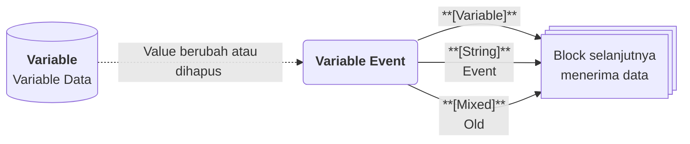

# Variable Event

>**note** Variable Event merupakan salah satu [[Docs/Modul Logic/Flow/Flow Block/Event/Pengenalan|Flow Block Event]] dalam komponen [[Docs/Modul Logic/Flow/Apa itu Flow|Flow]] di Phoenix.

Variable Event adalah Flow Block Event yang memulai alur ketika Value pada Variable Data di komponen [[Docs/Modul Data/Variable/Apa itu Variable|Variable]] berubah atau Variable Data dihapus. Block ini menghasilkan tiga output: [[^output|Variable]] yang berubah, [[^output|Event]] yang menjelaskan jenis perubahannya, dan [[^output|Old]] yang berisi nilai sebelum perubahan.

Dengan Variable Event, perubahan pada pengaturan global, seperti batas nilai, mode, atau tautan layanan, dapat langsung memicu otomasi tanpa Anda perlu memeriksanya secara manual.
![[Docs/Modul Logic/Flow/Flow Block/Event/variable-event.png|Variable Event Block pada Blueprint]]

## Kapan Variable Event Terpicu

Variable Event terpicu ketika Variable Data yang terhubung mengalami salah satu dari dua peristiwa berikut.

| Peristiwa | Nilai [[^output|Event]] |
| --- | --- |
| Value Variable Data berubah | [[^value/string|update]] |
| Variable Data dihapus | [[^value/string|delete]] |

>**note** Variable Event tidak memiliki Event create
> Variable Event hanya menghasilkan [[^value/string|update]] dan [[^value/string|delete]]. Event [[^value/string|update]] hanya terpicu ketika Value benar-benar berubah, dan perubahan yang dilakukan oleh Flow tidak memicu Flow kembali.

## Control dan Output

Variable Event tidak memiliki input koneksi. Block ini memiliki satu Control berupa tombol dan tiga output di sisi kanan.

| Bagian | Jenis | Tipe Data | Penjelasan |
| --- | --- | --- | --- |
| [[^button/empty|Trigger]] | Control | - | Memicu Variable Event secara manual dari Blueprint. |
| [[^output|Variable]] | Output | [[Docs/Tipe Data/Variable]] | Variable Data yang berubah atau dihapus. |
| [[^output|Event]] | Output | [[Docs/Tipe Data/String]] | Jenis peristiwa: [[^value/string|update]] atau [[^value/string|delete]]. |
| [[^output|Old]] | Output | Sesuai Type Variable Data (update) atau [[Docs/Tipe Data/Object]] (delete) | Value sebelum perubahan, atau seluruh atribut Variable Data yang dihapus. Isinya bergantung pada nilai [[^output|Event]]. |

### Isi Output Berdasarkan Event

| Nilai [[^output|Event]] | Isi [[^output|Variable]] | Isi [[^output|Old]] |
| --- | --- | --- |
| [[^value/string|update]] | Variable Data dengan Value terbaru. | Value sebelum perubahan, bertipe sesuai Type Variable Data. |
| [[^value/string|delete]] | Variable Data yang dihapus. | Object berisi seluruh atribut: Name, Type, Value, dan Description. |

Berbeda dengan [[Docs/Modul Logic/Flow/Flow Block/Event/Table Row Event#Isi Output Berdasarkan Event|Table Row Event]], [[Docs/Modul Logic/Flow/Flow Block/Event/Enum Data Event#Isi Output Berdasarkan Event|Enum Data Event]], dan [[Docs/Modul Logic/Flow/Flow Block/Event/Tree Node Event#Isi Output Berdasarkan Event|Tree Node Event]], [[^output|Old]] pada [[^value/string|update]] berisi langsung Value sebelumnya, bukan Object.

## Menggunakan Variable Event

1. Klik kanan pada bagian kosong Blueprint ➜ [[^field/add|Add]] ➜ [[^field|Event]] ➜ [[^field|Variable Event]].
2. Hubungkan Variable Event dengan Variable Data lewat tombol [[^button/event|Event]] pada baris Variable yang diinginkan, atau klik kanan pada daftar Variable ➜ [[^field|Setup Event]]. Langkah lengkap ada di [[Docs/Modul Data/Variable/Mengotomasi|Mengotomasi Variable]] dan [[Docs/Event/Menghubungkan Event|Menghubungkan Event]].
3. Hubungkan output [[^output|Variable]], [[^output|Event]], atau [[^output|Old]] ke input block berikutnya. Langkah lengkap ada di [[Docs/Modul Logic/Flow/Flow Block/Menghubungkan Koneksi|Menghubungkan Koneksi]].

## Contoh Penggunaan

Isi output [[^output|Variable]] selalu memiliki bentuk yang sama, yaitu Name, Type, Value, dan Description. Yang berbeda adalah tipe Value yang dibawanya, dan Value tersebut juga menjadi isi [[^output|Old]] ketika nilainya sebelum perubahan.

### Integrasi ketika nilai angka berubah

Gunakan ketika sebuah angka pengaturan, misalnya batas stok minimum, diperbarui dan sistem lain perlu mengetahuinya.

| Peristiwa | Output [[^output|Variable]] | Output [[^output|Event]] | Output [[^output|Old]] |
| --- | --- | --- | --- |
| Value diubah dari [[^value/number|10]] menjadi [[^value/number|25]] | Name `batas_stok_minimum`, Type [[Docs/Tipe Data/Number]], Value [[^value/number|25]] | [[^value/string|update]] | [[^value/number|10]] |
| Value diubah dari [[^value/number|25]] menjadi [[^value/number|0]] | Name sama, Type [[Docs/Tipe Data/Number]], Value [[^value/number|0]] | [[^value/string|update]] | [[^value/number|25]] |

Kombinasi yang berguna: [[^output|Variable]] untuk mengirim nilai terbaru, [[^output|Old]] untuk membandingkan apakah nilai naik atau turun.

### Otomasi ketika pengaturan aktif atau nonaktif

Gunakan ketika sebuah saklar pengaturan, misalnya mode pemeliharaan, diubah dan alur perlu menyesuaikan perilakunya.

| Peristiwa | Output [[^output|Variable]] | Output [[^output|Event]] | Output [[^output|Old]] |
| --- | --- | --- | --- |
| Value diubah dari [[^value/boolean/false]] menjadi [[^value/boolean/true]] | Name `mode_pemeliharaan`, Type [[Docs/Tipe Data/Boolean]], Value [[^value/boolean/true]] | [[^value/string|update]] | [[^value/boolean/false]] |
| Value diubah dari [[^value/boolean/true]] menjadi [[^value/boolean/false]] | Name sama, Type [[Docs/Tipe Data/Boolean]], Value [[^value/boolean/false]] | [[^value/string|update]] | [[^value/boolean/true]] |

Kombinasi yang berguna: [[^output|Variable]] membawa status saat ini, sehingga alur dapat langsung memilih tindakan untuk kondisi aktif atau nonaktif.

### Otomasi ketika teks atau tanggal berubah

Gunakan ketika pengaturan berupa teks, seperti tautan layanan atau nama periode, atau berupa tanggal diganti dan sistem lain perlu menerima nilai terbarunya.

| Peristiwa | Output [[^output|Variable]] | Output [[^output|Event]] | Output [[^output|Old]] |
| --- | --- | --- | --- |
| Value teks diganti dari [[^value/string|2026-Q3]] menjadi [[^value/string|2026-Q4]] | Name `periode_aktif`, Type [[Docs/Tipe Data/String]], Value [[^value/string|2026-Q4]] | [[^value/string|update]] | [[^value/string|2026-Q3]] |
| Value tanggal diganti dari `2026-09-30` menjadi `2026-12-31` | Name `tanggal_tutup_buku`, Type [[Docs/Tipe Data/Date]], Value `2026-12-31` | [[^value/string|update]] | `2026-09-30` |

### Otomasi ketika Variable Data dihapus

Gunakan ketika penghapusan sebuah pengaturan perlu dicatat atau diteruskan ke sistem lain.

| Peristiwa | Output [[^output|Variable]] | Output [[^output|Event]] | Output [[^output|Old]] |
| --- | --- | --- | --- |
| Variable Data `mode_pemeliharaan` dihapus | Variable Data yang dihapus, dengan Value terakhir [[^value/boolean/false]] | [[^value/string|delete]] | [[^value/object|{ "Name": "mode_pemeliharaan", "Type": "Boolean", "Value": false, "Description": "..." }]] |

Kombinasi yang berguna: [[^output|Old]] menyimpan seluruh atribut Variable Data yang dihapus, sehingga Anda masih dapat mencatat Name dan Description-nya.

## Lihat Juga

- [[Docs/Modul Logic/Flow/Flow Block/Event/Pengenalan|Flow Block Event]]
- [[Docs/Modul Data/Variable/Apa itu Variable|Variable]]
- [[Docs/Modul Data/Variable/Mengotomasi|Mengotomasi Variable]]
- [[Docs/Tipe Data/Variable]]
- [[Docs/Modul Logic/Flow/Flow Activity|Flow Activity]]
