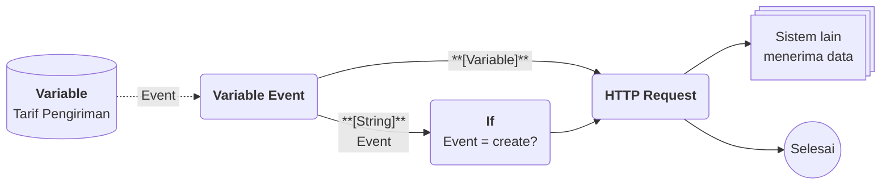
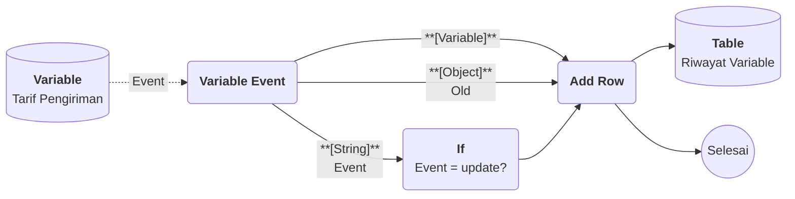
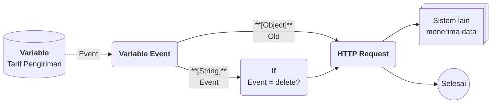

# Flow Block Event : Variable Event

>**note** Variable Event merupakan salah satu Flow Block kategori [[Docs/Modul Logic/Flow/Flow Block/Event/Pengenalan|Event]] pada komponen [[Docs/Modul Logic/Flow/Apa itu Flow|Flow]] dalam modul [[Docs/Modul Logic/Pengenalan|Logic]] di Phoenix.

Variable Event adalah Flow Block Event yang berjalan setiap kali Variable Data pada komponen [[Docs/Modul Data/Variable/Apa itu Variable|Variable]] ditambahkan, diperbarui, atau dihapus. Block ini membawa [[Docs/Tipe Data/Variable]] yang berubah, jenis kejadiannya, dan data sebelum perubahan.

Dengan Variable Event, perubahan pada nilai yang dipakai bersama, misalnya tarif atau pengaturan, dapat langsung diteruskan ke sistem lain atau diolah oleh block berikutnya.

## Kapan Variable Event Berjalan

Variable Event berjalan setiap kali Variable Data pada [[Docs/Modul Data/Variable/Apa itu Variable|Variable]] berubah. Jenis perubahannya dibedakan oleh output [[^field|Event]].

| Kejadian | [[^field|Event]] | [[^field|Variable]] | [[^field|Old]] |
| --- | --- | --- | --- |
| Variable Data baru ditambahkan | `create` | Variable Data yang baru ditambahkan | `NULL` |
| Variable Data diperbarui | `update` | Variable Data setelah diperbarui | Variable Data sebelum diperbarui |
| Variable Data dihapus | `delete` | Variable Data yang dihapus | Variable Data sebelum dihapus |

<!--
  * [TODO] Konfirmasi: pada kejadian delete, apakah output Variable berisi Variable Data yang dihapus atau kosong? Contoh di bawah memakai Old sebagai sumber data pada kasus delete agar aman.
  * [TODO] Konfirmasi: apakah Old juga NULL pada update yang tidak mengubah nilai apa pun?
-->

## Antarmuka Variable Event

![[Docs/Modul Logic/Flow/Flow Block/Event/block-variable-event.png]]

<!--
  * [TODO] Letakkan gambar block-variable-event.png (potongan block Variable Event) di sini. Screenshot yang dilampirkan belum memuat output Event dan Old, mohon diperbarui. Anotasi yang disarankan: (1) input pemicu, (2) judul, (3) tombol Trigger, (4) output.
-->

### Input

| Input | Penjelasan |
| --- | --- |
| Input pemicu | Tanda segitiga biru di sebelah kiri judul. Input ini memungkinkan block dipicu dan berlaku untuk semua Flow Block. Pada Variable Event input ini jarang dibutuhkan, karena block sudah dijalankan oleh kejadian dari Variable. |

### Output

| Output | Tipe Data | Penjelasan |
| --- | --- | --- |
| [[^field|Variable]] | [[Docs/Tipe Data/Variable]] | Variable Data yang ditambahkan, diperbarui, atau dihapus. |
| [[^field|Event]] | [[Docs/Tipe Data/String]] | Jenis kejadian. Nilainya salah satu dari `create`, `update`, atau `delete`. |
| [[^field|Old]] | [[Docs/Tipe Data/Object]] | Data sebelum perubahan. Bernilai `NULL` bila tidak ada data sebelumnya, misalnya pada `create`. |

Selengkapnya tentang [[^field|Event]] dan [[^field|Old]] lihat [[Docs/Modul Logic/Flow/Flow Block/Event/Pengenalan#Output Event dan Old|Output Event dan Old]].

## Menambahkan dan Menghubungkan Variable Event

Tambahkan block lewat menu [[^field/add|Add]] ➜ [[^field|Event]] ➜ [[^field|Variable Event]] di Blueprint. Cara lengkapnya ada di [[Docs/Modul Logic/Flow/Flow Block/Pengenalan#Menambahkan Flow Block|Menambahkan Flow Block]]. Setelah itu:

- Hubungkan block ke komponen Variable sesuai langkah di [[Docs/Event/Menghubungkan Event]].
- Hubungkan output [[^field|Variable]], [[^field|Event]], dan [[^field|Old]] ke block lain lewat [[Docs/Modul Logic/Flow/Flow Block/Pengenalan#Menghubungkan Koneksi|Menghubungkan Koneksi]]. Anda tidak harus memakai ketiganya.

## Menjalankan Variable Event Secara Manual

1. Buka Flow yang berisi Variable Event
2. Klik [[^button/empty|Trigger]] pada Variable Event
3. Pada modal yang tampil, pilih [[Docs/Tipe Data/Variable]] yang ingin dipakai
4. Konfirmasi pilihan Anda

[[Docs/Tipe Data/Variable]] yang dipilih dikeluarkan lewat output [[^field|Variable]], lalu alur berjalan seperti saat kejadian terjadi pada Variable. Prosesnya tercatat di [[Docs/Modul Logic/Flow/Flow Activity]].

<!--
  * [TODO] Konfirmasi nilai output Event dan Old ketika block dijalankan manual lewat Trigger, serta label tombol konfirmasi pada modal.
-->

## Contoh Penggunaan

Variable Event berjalan untuk `create`, `update`, dan `delete`. Karena itu setiap contoh memakai block [[Docs/Modul Logic/Flow/Flow Block/Operator/If|If]] untuk menyaring output [[^field|Event]], sehingga alur hanya menangani kejadian yang dibutuhkan.

**Integrasi ketika Variable baru ditambahkan**

Variable pengaturan baru, misalnya tarif, perlu langsung disalin ke sistem lain agar kedua sistem memakai pengaturan yang sama.

| Block | Peran dalam alur |
| --- | --- |
| [[Docs/Modul Logic/Flow/Flow Block/Event/Variable Event|Variable Event]] | Berjalan untuk setiap kejadian pada Variable dan mengeluarkan [[^field|Variable]] serta [[^field|Event]]. |
| [[Docs/Modul Logic/Flow/Flow Block/Operator/If|If]] | Meneruskan alur hanya bila [[^field|Event]] bernilai `create`. |
| [[Docs/Modul Logic/Flow/Flow Block/Modular/HTTP Request|HTTP Request]] | Mengirim [[Docs/Tipe Data/Variable]] baru ke sistem lain. |

Hasil yang dirasakan: pengaturan baru langsung tersedia di sistem lain.

**Otomasi ketika Variable diperbarui**

Perubahan nilai pengaturan perlu dicatat berikut nilai sebelumnya, sebagai riwayat perubahan.

| Block | Peran dalam alur |
| --- | --- |
| [[Docs/Modul Logic/Flow/Flow Block/Event/Variable Event|Variable Event]] | Mengeluarkan [[^field|Variable]] (data baru), [[^field|Old]] (data sebelumnya), dan [[^field|Event]]. |
| [[Docs/Modul Logic/Flow/Flow Block/Operator/If|If]] | Meneruskan alur hanya bila [[^field|Event]] bernilai `update`. |
| [[Docs/Modul Logic/Flow/Flow Block/Data/Add Row|Add Row]] | Menambahkan catatan perubahan, berisi nilai baru dan nilai sebelumnya, ke Table riwayat. |

Hasil yang dirasakan: setiap perubahan pengaturan tercatat otomatis dengan nilai sebelum dan sesudahnya.

**Otomasi ketika Variable dihapus**

Saat sebuah Variable dihapus, sistem lain perlu diberi tahu agar pengaturan yang sama tidak lagi dipakai di sana.

| Block | Peran dalam alur |
| --- | --- |
| [[Docs/Modul Logic/Flow/Flow Block/Event/Variable Event|Variable Event]] | Mengeluarkan [[^field|Old]] berisi data Variable sebelum dihapus, serta [[^field|Event]]. |
| [[Docs/Modul Logic/Flow/Flow Block/Operator/If|If]] | Meneruskan alur hanya bila [[^field|Event]] bernilai `delete`. |
| [[Docs/Modul Logic/Flow/Flow Block/Modular/HTTP Request|HTTP Request]] | Mengirim data dari [[^field|Old]] ke sistem lain sebagai penanda penghapusan. |

Hasil yang dirasakan: pengaturan di sistem lain tetap sejalan dengan Variable.

### Variasi Kombinasi Output

| Output yang dipakai | Cocok untuk |
| --- | --- |
| [[^field|Variable]] saja | Memproses Variable Data tanpa membedakan jenis kejadian. |
| [[^field|Variable]] dan [[^field|Event]] | Satu alur untuk tiga kejadian, disaring dengan [[Docs/Modul Logic/Flow/Flow Block/Operator/If|If]]. |
| [[^field|Variable]] dan [[^field|Old]] | Membandingkan data baru dengan data sebelumnya pada `update`. |
| [[^field|Event]] dan [[^field|Old]] | Mencatat riwayat perubahan atau mengarsipkan data. |
| [[^field|Old]] saja | Menangani `delete` memakai data sebelum dihapus. |

Dengan Variable Event, perubahan nilai bersama dapat langsung disebarkan dan dicatat.

<!--
  * [TODO] Nama konteks pada Contoh Penggunaan sudah dibuat generik (Variable Tarif Pengiriman dan Table Riwayat Variable). Sesuaikan bila perlu.
  * [TODO] Saya mengasumsikan If dapat memeriksa output Event dan meneruskan alur hanya bila kondisi terpenuhi. Mohon konfirmasi nama output dan cara penyambungan If.
  * [TODO] Pada contoh Add Row, saya mengasumsikan Add Row dapat menerima data Object. Mohon konfirmasi.
  * [TODO] Asumsi halaman baru yang ditautkan: Docs/Modul Logic/Flow/Flow Block/Operator/If, Docs/Modul Logic/Flow/Flow Block/Data/Add Row, Docs/Modul Logic/Flow/Flow Block/Modular/HTTP Request, Docs/Modul Logic/Flow/Flow Block/Operator/Node Parse, Docs/Event/Menghubungkan Event, Docs/Modul Data/Variable/Apa itu Variable, Docs/Modul Logic/Flow/Flow Activity, dan Docs/Modul Logic/Pengenalan.
  * [TODO] Bilah navigasi Variable pada knowledge saya belum memiliki tombol Event. Mohon konfirmasi cara menghubungkan Variable Event ke komponen Variable, lalu perbarui bagian Menambahkan dan Menghubungkan Variable Event.
-->

## Block Terkait

- [[Docs/Modul Logic/Flow/Flow Block/Event/Pengenalan|Pengenalan Event]]: perbandingan Variable Event dengan block Event lain.
- [[Docs/Modul Data/Variable/Apa itu Variable|Variable]]: komponen sumber kejadian.
- [[Docs/Modul Logic/Flow/Flow Block/Data/Add Row|Add Row]]: menambahkan Row dari alur.
- [[Docs/Modul Logic/Flow/Flow Block/Modular/HTTP Request|HTTP Request]]: mengirim hasil alur ke sistem lain.