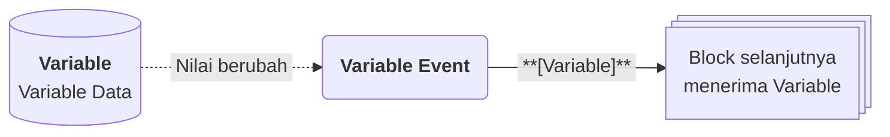

# Variable Event

>**note** Variable Event merupakan salah satu [[Docs/Modul Logic/Flow/Flow Block/Event/Pengenalan|Flow Block Event]] dalam komponen [[Docs/Modul Logic/Flow/Apa itu Flow|Flow]] di Phoenix.

Variable Event adalah Flow Block Event yang memulai alur ketika data pada komponen [[Docs/Modul Data/Variable/Apa itu Variable|Variable]] berubah. Block ini menghasilkan satu output, yaitu [[Docs/Tipe Data/Variable]] yang berisi Name, Type, Value, dan Description dari data yang berubah.

Dengan Variable Event, perubahan pada pengaturan global, seperti batas nilai, mode, atau tautan layanan, dapat langsung memicu otomasi tanpa Anda perlu memeriksanya secara manual.

![[Docs/Modul Logic/Flow/Flow Block/Event/variable-event.png|Variable Event Block pada Blueprint]]
<!--
  * [DONE] Letakkan potongan gambar Variable Event dari screenshot (file `variable-event.png`). Anotasi yang disarankan: nomor 1 pada judul, nomor 2 pada tombol Trigger, nomor 3 pada output Variable.
-->

## Kapan Variable Event Terpicu

Variable Event terpicu ketika data pada komponen [[Docs/Modul Data/Variable/Apa itu Variable|Variable]] yang terhubung berubah.

<!--
  * [DONE] Konfirmasi peristiwa yang memicu Variable Event: ubah Value saja, atau juga tambah dan hapus Variable Data. Draf ini mengasumsikan ketika Value berubah.
  * [TODO] Komponen Variable tidak memiliki tombol Event pada bilah navigasi menurut knowledge. Konfirmasi cara Variable Event dihubungkan (apakah ke satu Variable Data tertentu atau ke seluruh komponen Variable).
  Jawaban: Ada di setiap baris variable. Dapat juga diatur dengan klik kanan pada daftar Variable -> Setup Event.
-->

## Input, Control dan Output

Variable Event tidak memiliki input koneksi. Block ini memiliki tiga output di sisi kanan.

| Bagian | Jenis | Tipe Data | Penjelasan |
| --- | --- | --- | --- |
| [[^button/empty\|Trigger]] | Control | - | Memicu Variable Event secara manual dari Blueprint. |
| [[^ouput|Variable]] | Output | [[Docs/Tipe Data/Variable]] | Variable Data yang berubah. |
| [[^ouput|Event]] | Output | [[Docs/Tipe Data/String]] | Jenis peristiwa: `update`, atau `delete`. |
| [[^ouput|Old]] | Output | Tergantung Type dari [[Docs/Tipe Data/Variable]] atau [[Docs/Tipe Data/Object]] | Value sebelum perubahan atau seluruh atribut variable. Isinya bergantung pada nilai `Event`. |

## Isi Output Berdasarkan Event

| Nilai `Event` | Isi `EnumData` | Isi `Old` |
| --- | --- | --- |
| `update` | Variable dengan nilai terbaru. | Hanya value diubah, berisi nilai sebelum perubahan. Jika tidak ada perubahan. |
| `delete` | Variable yang dihapus. | Seluruh field: Name, Description, dan Value. |

Aturan `Event` dan `Old` yang sama juga berlaku pada [[Docs/Modul Logic/Flow/Flow Block/Event/Pengenalan#Output Event dan Old|Table Row Event dan Tree Node Event]].

>**note** Tidak ada output Event create
> Berbeda dengan [[Docs/Modul Logic/Flow/Flow Block/Event]]lainnya, Variable Event tidak menghasilkan output `Event` create. Block ini tidak membedakan jenis perubahan dan tidak membawa nilai sebelumnya.

## Menggunakan Variable Event

1. Klik kanan pada bagian kosong Blueprint ➜ [[^field/add|Add]] ➜ [[^field|Event]] ➜ [[^field|Variable Event]].
2. Hubungkan Variable Event dengan komponen [[Docs/Modul Data/Variable/Apa itu Variable|Variable]]. Langkah lengkap ada di [[Docs/Event/Menghubungkan Event|Menghubungkan Event]].
3. Hubungkan output `Variable` ke input block berikutnya. Langkah lengkap ada di [[Docs/Modul Logic/Flow/Flow Block/Menghubungkan Koneksi|Menghubungkan Koneksi]].

## Contoh Penggunaan

Isi output `Variable` selalu memiliki bentuk yang sama, yaitu Name, Type, Value, dan Description. Yang berbeda adalah tipe Value yang dibawanya. Tiga contoh berikut menunjukkan variasi yang paling sering berguna.

### Integrasi ketika nilai angka berubah

Gunakan ketika sebuah angka pengaturan, misalnya batas stok minimum, diperbarui dan sistem lain perlu mengetahuinya.

| Perubahan pada Variable Data | Output `Variable` |
| --- | --- |
| Value diubah dari `10` menjadi `25` | Name `batas_stok_minimum`, Type [[Docs/Tipe Data/Number]], Value `25`, Description sesuai isian. |
| Value diubah menjadi `0` | Name sama, Type [[Docs/Tipe Data/Number]], Value `0`. |

### Otomasi ketika pengaturan aktif atau nonaktif

Gunakan ketika sebuah saklar pengaturan, misalnya mode pemeliharaan, diubah dan alur perlu menyesuaikan perilakunya.

| Perubahan pada Variable Data | Output `Variable` |
| --- | --- |
| Value diubah dari `false` menjadi `true` | Name `mode_pemeliharaan`, Type [[Docs/Tipe Data/Boolean]], Value `true`. |
| Value diubah dari `true` menjadi `false` | Name sama, Type [[Docs/Tipe Data/Boolean]], Value `false`. |

### Otomasi ketika teks atau tanggal berubah

Gunakan ketika pengaturan berupa teks, seperti tautan layanan atau nama periode, diganti dan sistem lain perlu menerima nilai terbarunya.

| Perubahan pada Variable Data | Output `Variable` |
| --- | --- |
| Value teks diganti | Name `periode_aktif`, Type [[Docs/Tipe Data/String]], Value sesuai teks baru. |
| Value tanggal diganti | Name `tanggal_tutup_buku`, Type [[Docs/Tipe Data/Date]], Value sesuai tanggal baru. |

<!--
  * [DONE] Nama Variable Data pada contoh (batas_stok_minimum, mode_pemeliharaan, periode_aktif, tanggal_tutup_buku) adalah penamaan generik buatan Claude. Sesuaikan bila perlu.
  * [TODO] Konfirmasi apakah perubahan yang tidak mengubah Value (misalnya menyimpan nilai yang sama) tetap memicu Variable Event.
    Jawaban: Tidak ada pengaruh. Event update hanya terpicu ketika ada perubahan value.
  * [TODO] Konfirmasi format penulisan Name Variable Data (huruf kecil dengan garis bawah hanya contoh).
    Jawaban: bebas, tidak ada aturan.
-->

## Lihat Juga

- [[Docs/Modul Logic/Flow/Flow Block/Event/Pengenalan|Flow Block Event]]
- [[Docs/Modul Data/Variable/Apa itu Variable|Variable]]
- [[Docs/Tipe Data/Variable]]
- [[Docs/Modul Logic/Flow/Flow Activity|Flow Activity]]
