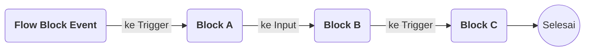

# Apa itu Flow Block

>**note** Flow Block merupakan bagian dari komponen [[Docs/Modul Logic/Flow/Apa itu Flow|Flow]] dalam modul [[Docs/Modul Logic/Pengenalan|Logic]] di Phoenix.

Flow Block adalah unit terkecil penyusun Flow. Setiap block memiliki fungsi, masukan, proses, dan keluaran yang berbeda-beda, dan dapat dihubungkan dengan block lain di [[Docs/Modul Logic/Flow/Apa itu Flow#Antarmuka Flow|Blueprint]] untuk membentuk logika.

Setiap Flow Block tersusun dari [[#Trigger]], [[#Input]], [[#Control]], dan [[#Output]]. Prinsip pada halaman ini berlaku untuk semua jenis Flow Block, sehingga halaman setiap jenis hanya menjelaskan bagian yang khas bagi block tersebut.

## Konsep Utama

| Istilah | Penjelasan |
| --- | --- |
| [[#Trigger]] | Input di sebelah kiri judul block yang berfungsi sebagai syarat block dijalankan. |
| [[#Input]] | Masukan data ke block untuk diproses lebih lanjut. |
| [[#Control]] | Antarmuka interaktif di badan block yang dapat memengaruhi proses block atau memicu Activity baru. |
| [[#Output]] | Keluaran block yang dapat dihubungkan ke Input atau Trigger block lain. |
| Flow Block Event | Flow Block pemicu yang tidak memiliki Trigger maupun Input. Selengkapnya lihat [[Docs/Modul Logic/Flow/Flow Block/Event/Pengenalan]]. |

## Anatomi Flow Block

![[Docs/Modul Logic/Flow/Flow Block/flowlock-anatomy.png]]
Bagian-bagian Flow Block ditempatkan pada posisi berikut:

![[Docs/Modul Logic/Flow/Flow Block/2026-11-02_19-31-16.png]]

| Bagian | Posisi pada block |
| --- | --- |
| [[#Trigger]] | Di sebelah kiri judul block |
| [[#Input]] | Di sisi kiri, di bawah judul block |
| [[#Control]] | Di badan block |
| [[#Output]] | Di sisi kanan block |

Tidak semua jenis Flow Block memiliki keempat bagian ini. Variasinya dijelaskan di [[#Variasi Antar Jenis Flow Block]].

### Trigger

[[#Trigger]] adalah Input yang berada di sebelah kiri judul block. Fungsinya sebagai syarat agar block dijalankan.

- Trigger dapat menerima koneksi dari banyak [[#Output]] sekaligus. Syarat terpenuhi bila setidaknya satu koneksi sudah berisi data, artinya block sebelumnya sudah tereksekusi.
- Trigger yang tidak memiliki koneksi dianggap selalu aktif.

> **note** Trigger dan tombol Trigger
> Trigger adalah bagian dari Flow Block yang menjadi syarat eksekusi. Tombol [[^button/empty|Trigger]] pada [[Docs/Modul Logic/Flow/Flow Block/Event/Pulser|Pulser]] adalah [[#Control]] dan tidak sama dengan Trigger ini.

### Input

[[#Input]] adalah masukan data ke block untuk diproses lebih lanjut.

- Input yang tidak terhubung menampilkan field isian sehingga nilainya dapat diisi langsung. Field ini hilang ketika Input terhubung ke [[#Output]] block lain.
- Bila satu Input menerima banyak koneksi, seluruh data dari koneksi tersebut dibaca sebagai [[Docs/Tipe Data/Array]] dalam proses block.
- Bila salah satu koneksi bersifat rekursif, yaitu ketika ditelusuri mundur akan kembali ke block yang sama, Input dibaca sebagai satu data dari aliran terakhir dan koneksi lainnya diabaikan.
- Apakah block tetap dapat berjalan ketika Input kosong bergantung pada block itu sendiri. Jika Input wajib diisi, kondisi kosong menghasilkan error pada [[Docs/Modul Logic/Flow/Flow Activity|Flow Activity]].

### Control

[[#Control]] adalah antarmuka interaktif di badan block yang dapat dioperasikan langsung di Blueprint. Control dapat memengaruhi proses yang terjadi pada Flow Block, atau memicu [[Docs/Modul Logic/Flow/Flow Activity|Activity]] baru.

- Saat ini Control yang tersedia berupa tombol [[^button/empty|Trigger]], misalnya pada [[Docs/Modul Logic/Flow/Flow Block/Event/Pulser|Pulser]] untuk menjalankan Flow secara manual.
- Tidak semua Flow Block memiliki Control.

### Output

[[#Output]] adalah keluaran block yang dapat dihubungkan ke [[#Input]] atau [[#Trigger]] block lain.

- Setiap Output hanya dapat terhubung dengan satu Input atau Trigger block lain. Aturan lengkapnya ada di [[#Aturan Koneksi]].
- Tipe data Output dapat bervariasi, dan kecocokannya dengan Input diperiksa saat Flow berjalan.

## Aturan Koneksi

Koneksi menghubungkan [[#Output]] sebuah block ke [[#Input]] atau [[#Trigger]] block lain. Jumlah koneksi yang diizinkan berbeda untuk setiap bagian:

| Bagian | Jumlah koneksi |
| --- | --- |
| [[#Output]] | Hanya terhubung dengan satu Input atau Trigger block lain |
| [[#Input]] | Dapat menerima koneksi sebanyak mungkin |
| [[#Trigger]] | Dapat menerima koneksi sebanyak mungkin |

Setiap koneksi harus memiliki tipe data yang cocok antara Output dan Input. Output dapat menghasilkan beberapa kemungkinan tipe data, dan Input yang lebih ketat tetap dapat menerimanya. Namun, jika data yang mengalir ternyata tidak cocok, error akan muncul di [[Docs/Modul Logic/Flow/Flow Activity|Flow Activity]].

Langkah menghubungkan dan memutus koneksi ada di [[Docs/Modul Logic/Flow/Flow Block/Menghubungkan Koneksi]] dan [[Docs/Modul Logic/Flow/Flow Block/Menghapus Koneksi]].

## Syarat Flow Block Diproses

Sebuah block diproses bila kedua syarat berikut terpenuhi:

1. Setiap [[#Input]] yang terhubung ke [[#Output]] block lain sudah memiliki data, artinya block sebelumnya sudah tereksekusi.
2. [[#Trigger]] memiliki data setidaknya satu, artinya block sebelumnya sudah tereksekusi. Jika Trigger tidak terhubung, syarat ini selalu terpenuhi.

> **note** Block tanpa Trigger dan Input terhubung
> Flow Block non-Event yang tidak memiliki koneksi pada [[#Trigger]] maupun [[#Input]] tidak menerima apa pun dari block lain, sehingga tidak akan aktif dalam [[Docs/Modul Logic/Flow/Flow Activity|Activity]].

### Gambaran Syarat pada Alur

| Block | Syarat terpenuhi karena |
| --- | --- |
| Block A | [[#Trigger]] terhubung ke Flow Block Event dan sudah berisi data setelah Event tereksekusi. |
| Block B | [[#Input]] terhubung ke [[#Output]] Block A dan sudah berisi data setelah Block A tereksekusi. [[#Trigger]] tidak terhubung sehingga selalu aktif. |
| Block C | [[#Trigger]] terhubung ke [[#Output]] Block B dan sudah berisi data setelah Block B tereksekusi. |

### Data pada Input selama Activity

Setelah block tereksekusi, data pada [[#Input]] dipertahankan selama [[Docs/Modul Logic/Flow/Flow Activity|Activity]] tersebut berjalan. Bila aliran Flow kembali ke block yang sama (rekursif), data terakhir yang akan digunakan.

## Variasi Antar Jenis Flow Block

Setiap jenis Flow Block memiliki variasi [[#Trigger]], [[#Input]], [[#Control]], dan [[#Output]] masing-masing. Ada jenis yang tidak memiliki Control, Input, atau Output. Contohnya Flow Block Event yang tidak memiliki Trigger maupun Input.

Pada halaman setiap jenis Flow Block, hanya variasi yang khas bagi block itu yang dijelaskan. Prinsip umum pada halaman ini, yaitu [[#Aturan Koneksi]] dan [[#Syarat Flow Block Diproses]], tidak diulang di sana.

## Jenis Flow Block

Pengkategorian Flow Block berfungsi agar memudahkan pencarian block. Selengkapnya bisa klik tautan per masing-masing kategori atau isinya.

| Kategori | Jenis Flow Block |
| --- | --- |
| [[Docs/Modul Logic/Flow/Flow Block/Event/Pengenalan|Event]] | [[Docs/Modul Logic/Flow/Flow Block/Event/Pulser]], [[Docs/Modul Logic/Flow/Flow Block/Event/Variable Event]], [[Docs/Modul Logic/Flow/Flow Block/Event/Enum Data Event]], [[Docs/Modul Logic/Flow/Flow Block/Event/Table Row Event]], [[Docs/Modul Logic/Flow/Flow Block/Event/Tree Node Event]] |
| [[Docs/Modul Logic/Flow/Flow Block/Data/Pengenalan|Data]] | [[Docs/Modul Logic/Flow/Flow Block/Data/Variable/Pengenalan|Variable]] ([[Docs/Modul Logic/Flow/Flow Block/Data/Variable/Add Variable]], [[Docs/Modul Logic/Flow/Flow Block/Data/Variable/Delete Variable]], [[Docs/Modul Logic/Flow/Flow Block/Data/Variable/Variable]], [[Docs/Modul Logic/Flow/Flow Block/Data/Variable/Variable Getter]], [[Docs/Modul Logic/Flow/Flow Block/Data/Variable/Variable Setter]], [[Docs/Modul Logic/Flow/Flow Block/Data/Variable/Variable Value]]); [[Docs/Modul Logic/Flow/Flow Block/Data/Enum/Pengenalan|Enum]] ([[Docs/Modul Logic/Flow/Flow Block/Data/Enum/Add EnumData]], [[Docs/Modul Logic/Flow/Flow Block/Data/Enum/Delete EnumData]], [[Docs/Modul Logic/Flow/Flow Block/Data/Enum/Enum]], [[Docs/Modul Logic/Flow/Flow Block/Data/Enum/EnumData]], [[Docs/Modul Logic/Flow/Flow Block/Data/Enum/EnumData Getter]], [[Docs/Modul Logic/Flow/Flow Block/Data/Enum/EnumData Setter]], [[Docs/Modul Logic/Flow/Flow Block/Data/Enum/EnumData Value]]); [[Docs/Modul Logic/Flow/Flow Block/Data/Table/Pengenalan|Table]] ([[Docs/Modul Logic/Flow/Flow Block/Data/Table/Add Row]], [[Docs/Modul Logic/Flow/Flow Block/Data/Table/Delete Row]], [[Docs/Modul Logic/Flow/Flow Block/Data/Table/Table]], [[Docs/Modul Logic/Flow/Flow Block/Data/Table/Table Column]], [[Docs/Modul Logic/Flow/Flow Block/Data/Table/Table Row]], [[Docs/Modul Logic/Flow/Flow Block/Data/Table/TableData Getter]], [[Docs/Modul Logic/Flow/Flow Block/Data/Table/TableData Setter]]); [[Docs/Modul Logic/Flow/Flow Block/Data/Tree/Pengenalan|Tree]] ([[Docs/Modul Logic/Flow/Flow Block/Data/Tree/Add Node]], [[Docs/Modul Logic/Flow/Flow Block/Data/Tree/Assign Node]], [[Docs/Modul Logic/Flow/Flow Block/Data/Tree/Delete Node]], [[Docs/Modul Logic/Flow/Flow Block/Data/Tree/Node]], [[Docs/Modul Logic/Flow/Flow Block/Data/Tree/Node Get Ancestor]], [[Docs/Modul Logic/Flow/Flow Block/Data/Tree/Node Get Children]], [[Docs/Modul Logic/Flow/Flow Block/Data/Tree/Node Get Parent]], [[Docs/Modul Logic/Flow/Flow Block/Data/Tree/Node Setter]], [[Docs/Modul Logic/Flow/Flow Block/Data/Tree/Tree]], [[Docs/Modul Logic/Flow/Flow Block/Data/Tree/Tree Get Origin]]) |
| [[Docs/Modul Logic/Flow/Flow Block/Input dan Output/Pengenalan|I/O]] | [[Docs/Modul Logic/Flow/Flow Block/Input dan Output/Branch]], [[Docs/Modul Logic/Flow/Flow Block/Input dan Output/Passer]] |
| [[Docs/Modul Logic/Flow/Flow Block/Query/Pengenalan|Query]] | [[Docs/Modul Logic/Flow/Flow Block/Query/Condition]], [[Docs/Modul Logic/Flow/Flow Block/Query/Execute]] |
| [[Docs/Modul Logic/Flow/Flow Block/Operator/Pengenalan|Operator]] | [[Docs/Modul Logic/Flow/Flow Block/Operator/Number/Pengenalan|Number]] ([[Docs/Modul Logic/Flow/Flow Block/Operator/Number/Increment]]); [[Docs/Modul Logic/Flow/Flow Block/Operator/String/Pengenalan|String]] ([[Docs/Modul Logic/Flow/Flow Block/Operator/String/Concatenate]], [[Docs/Modul Logic/Flow/Flow Block/Operator/String/Implode]], [[Docs/Modul Logic/Flow/Flow Block/Operator/String/Pad Left]], [[Docs/Modul Logic/Flow/Flow Block/Operator/String/Pad Right]]); [[Docs/Modul Logic/Flow/Flow Block/Operator/Table/Pengenalan|Table]] ([[Docs/Modul Logic/Flow/Flow Block/Operator/Table/TableRow Parse]]); [[Docs/Modul Logic/Flow/Flow Block/Operator/Object/Pengenalan|Object]] ([[Docs/Modul Logic/Flow/Flow Block/Operator/Object/Assign]], [[Docs/Modul Logic/Flow/Flow Block/Operator/Object/Merge]], [[Docs/Modul Logic/Flow/Flow Block/Operator/Object/Parse]], [[Docs/Modul Logic/Flow/Flow Block/Operator/Object/Stringify]]); [[Docs/Modul Logic/Flow/Flow Block/Operator/Boolean/Pengenalan|Boolean]] ([[Docs/Modul Logic/Flow/Flow Block/Operator/Boolean/If]]); [[Docs/Modul Logic/Flow/Flow Block/Operator/Tree/Pengenalan|Tree]] ([[Docs/Modul Logic/Flow/Flow Block/Operator/Tree/Node Parse]]) |
| [[Docs/Modul Logic/Flow/Flow Block/Modular/Pengenalan|Modular]] | [[Docs/Modul Logic/Flow/Flow Block/Modular/API/Pengenalan|API]] ([[Docs/Modul Logic/Flow/Flow Block/Modular/API/HTTP Request]]); [[Docs/Modul Logic/Flow/Flow Block/Modular/AI/Pengenalan|AI]] ([[Docs/Modul Logic/Flow/Flow Block/Modular/AI/OpenAI 4]]) |
| Misc | [[Docs/Modul Logic/Flow/Flow Block/Chrono/Pengenalan|Chrono]] ([[Docs/Modul Logic/Flow/Flow Block/Chrono/Delay]]); [[Docs/Modul Logic/Flow/Flow Block/Error/Pengenalan|Error]] ([[Docs/Modul Logic/Flow/Flow Block/Error/Error Message]]) |

## Mengelola Flow Block

Berikut adalah cara mengelola Flow Block didalam Flow:

1. [[Docs/Modul Logic/Flow/Flow Block/Menambahkan]]
2. [[Docs/Modul Logic/Flow/Flow Block/Menghapus]]
3. [[Docs/Modul Logic/Flow/Flow Block/Menghubungkan Koneksi]]
4. [[Docs/Modul Logic/Flow/Flow Block/Menghapus Koneksi]]

## TL:DR

- Flow Block adalah unit terkecil penyusun Flow yang tersusun dari [[#Trigger]], [[#Input]], [[#Control]], dan [[#Output]]. Tidak semua jenis memiliki keempatnya.
- Setiap [[#Output]] hanya terhubung ke satu [[#Input]] atau [[#Trigger]], sedangkan Input dan Trigger dapat menerima koneksi sebanyak mungkin ([[#Aturan Koneksi]]).
- Flow Block non-Event diproses bila setiap Input yang terhubung sudah berisi data dan Trigger berisi data setidaknya satu. Trigger yang tidak terhubung selalu aktif ([[#Syarat Flow Block Diproses]]).
- Input yang tidak terhubung menampilkan field isian, dan banyak koneksi pada satu Input dibaca sebagai [[Docs/Tipe Data/Array]].
- [[#Control]] dapat memengaruhi proses block atau memicu Activity baru.
- Error karena Input wajib kosong atau tipe data tidak cocok tampil di [[Docs/Modul Logic/Flow/Flow Activity|Flow Activity]].

## FAQ : Pertanyaan yang Sering Diajukan

> **faq**
> **Apa bedanya Trigger dan Input?**
> [[#Trigger]] menjadi syarat agar block dijalankan, sedangkan [[#Input]] adalah masukan data yang diproses block.
> **Mengapa Flow Block saya tidak berjalan?**
> Periksa [[#Syarat Flow Block Diproses]]: setiap Input yang terhubung harus sudah berisi data dan Trigger harus berisi data setidaknya satu. Flow Block non-Event yang tidak terhubung pada Trigger maupun Input juga tidak akan aktif dalam Activity.
> **Dapatkah satu Output dihubungkan ke beberapa block?**
> Tidak. Setiap [[#Output]] hanya dapat terhubung dengan satu Input atau Trigger block lain, lihat [[#Aturan Koneksi]].
> **Apa yang terjadi jika beberapa Output dihubungkan ke satu Input?**
> Data dari seluruh koneksi dibaca sebagai [[Docs/Tipe Data/Array]]. Pengecualian berlaku bila ada koneksi rekursif, lihat [[#Input]].
> **Mengapa field isian pada Input hilang?**
> Field isian hanya tampil pada [[#Input]] yang tidak terhubung. Ketika Input terhubung ke Output block lain, nilainya berasal dari koneksi tersebut.